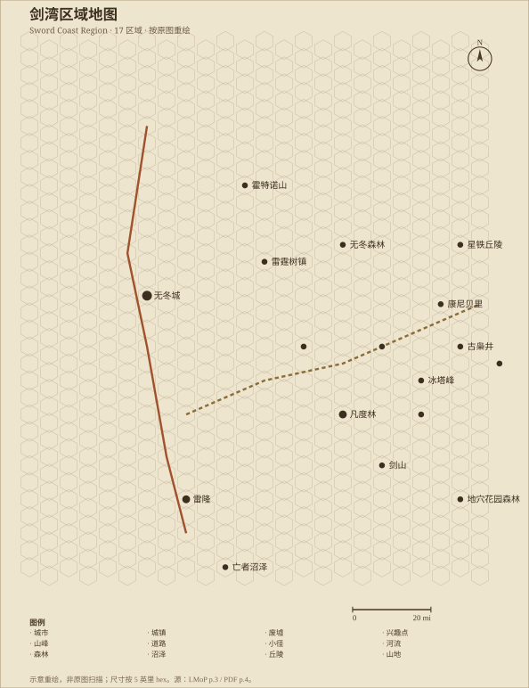
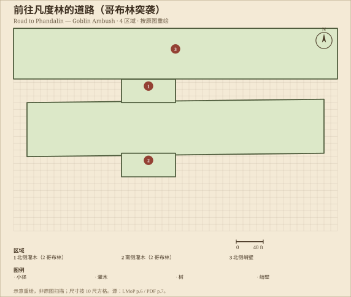
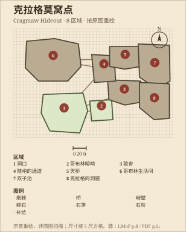
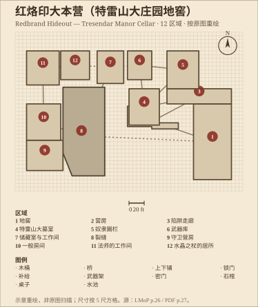
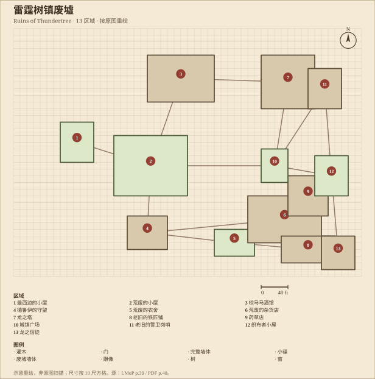
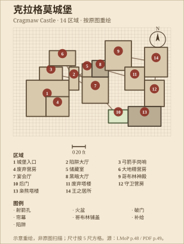
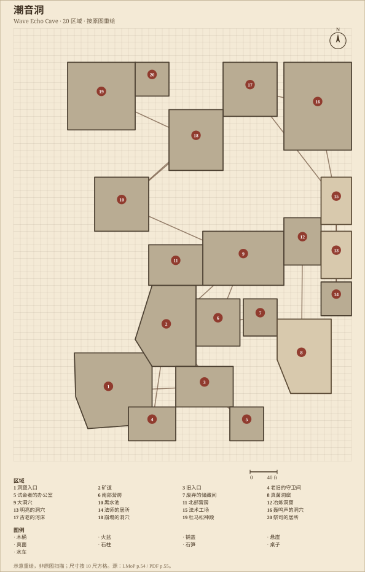
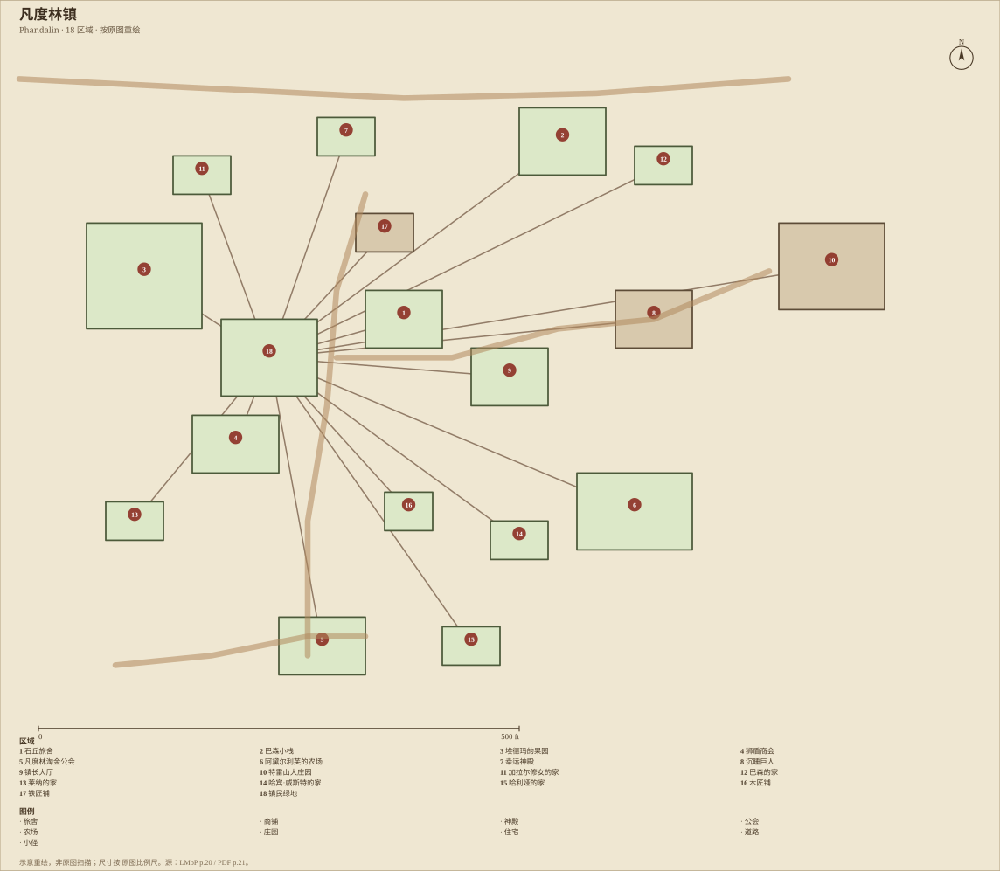

# 《凡戴尔的失落矿坑》地图与规则对照图集

> 对象：D&D 5e（2014）入门模组《凡戴尔的失落矿坑》（Lost Mine of Phandelver）的**地图、场景与规则对照**。
> 数据：`data/lmop/maps.json`、`data/lmop/rules.json`、`data/lmop/rules-crossref.json`；示意图：`data/lmop/map-schematics/`。
> 本图集不收录原图扫描或模组译文正文；地图为按原图方格/比例尺重绘的**示意矢量图**，场景文字为生成式摘要。

## 1. 坐标、比例与精度

- `maps.json` 中每张图使用独立坐标系：原点在左上角，x 向东、y 向南，单位为英尺（区域地图为 hex）。
- `scale.feet_per_square` 是原图方格边长；`footprint` 是多边形顶点，`ceiling_ft` 是默认净高，`elevation_ft` 是相对标高。
- 示意几何按原图方格计数或比例尺重绘，地下城误差约 ±1 格（5 尺），室外约 ±1 格（10 尺）；精确尺寸以原图与 DM 判断为准。
- 原图未标注的地点（克拉格莫城堡、潮音洞、飞龙崖）在区域图上只给推算 hex，并标 `map_label:false`，不作为精确位置。

## 2. 总览

| 地图 | 类型 | 书内页 / PDF | 比例 | 区域 | 场景记录 | 示意图 |
|---|---|---|---:|---:|---|---|
| 剑湾区域地图 | 区域图 | 3 / 4 | 5 mi/hex | 17 | — | [SVG](../../data/lmop/map-schematics/map-sword-coast-region.svg) |
| 前往凡度林的道路（哥布林突袭） | 战斗地图 | 6 / 7 | 10 ft/格 | 4 | 哥布林突袭 | [SVG](../../data/lmop/map-schematics/map-road-to-phandalin.svg) |
| 克拉格莫窝点 | 地下城 | 8 / 9 | 5 ft/格 | 8 | 克拉格莫窝点 | [SVG](../../data/lmop/map-schematics/map-cragmaw-hideout.svg) |
| 红烙印大本营（特雷山大庄园地窖） | 地下城 | 26 / 27 | 5 ft/格 | 12 | 红烙印大本营（总览） | [SVG](../../data/lmop/map-schematics/map-redbrand-hideout.svg) |
| 雷霆树镇废墟 | 野外地点 | 39 / 40 | 10 ft/格 | 13 | 雷霆树镇 | [SVG](../../data/lmop/map-schematics/map-thundertree.svg) |
| 克拉格莫城堡 | 地下城 | 48 / 49 | 5 ft/格 | 14 | 克拉葛摩城堡 | [SVG](../../data/lmop/map-schematics/map-cragmaw-castle.svg) |
| 潮音洞 | 地下城 | 54 / 55 | 10 ft/格 | 20 | — | [SVG](../../data/lmop/map-schematics/map-wave-echo-cave.svg) |
| 凡度林镇 | 城镇 | 20 / 21 | 比例尺 | 18 | 凡度林镇（总览） | [SVG](../../data/lmop/map-schematics/map-phandalin.svg) |

## 3. 地图与场景

### 3.1 剑湾区域地图（Sword Coast Region）



- 页码：书内 3 / PDF 4；类型：区域图。
- 比例：1 hex = 5 英里；画布 24×32 hex。
- 环境：海岸、森林、丘陵、山地、沼泽；1 hex = 5 miles；队伍每日约 24 英里。
- 布局：北起无冬城与无冬森林，南至雷隆与亡者沼泽；大道沿海南北纵贯，三猪小径从大道向东穿过凡度林以北，通往康尼贝里与古枭井。
- 精度：按原图 hex 网格重绘；未标注地点（克拉格莫城堡、潮音洞、飞龙崖）的 hex 为文字描述推算。

**地点**

| 地点 | 英文 | 类型 | hex | 场景 | 备注 |
|---|---|---|---:|---|---|
| 无冬城 | Neverwinter | city | 6,15 | — | 原图标注 |
| 雷霆树镇 | Thundertree | ruins | 12,13 | 雷霆树镇 | 原图标注 |
| 康尼贝里 | Conyberry | ruins | 21,15 | 兔子浆果镇与阿嘉莎的巢穴 | 原图标注 |
| 古枭井 | Old Owl Well | point_of_interest | 22,18 | 古枭井 | 原图标注 |
| 凡度林 | Phandalin | town | 16,22 | 凡度林镇（总览） | 原图标注 |
| 雷隆 | Leilon | town | 8,27 | — | 原图标注 |
| 克拉格莫窝点（推算） | Cragmaw Hideout (approx.) | dungeon | 14,18 | 克拉格莫窝点 | 原图未标注；据「小径向北 5 英里」推算。 |
| 克拉格莫城堡（推算） | Cragmaw Castle (approx.) | dungeon | 18,18 | 克拉葛摩城堡 | 原图未标注；据「窝点东北约 20 英里、无冬森林中」推算。 |
| 潮音洞（推算） | Wave Echo Cave (approx.) | dungeon | 20,22 | 洞窟入口 | 原图未标注；据「凡度林以东 15 英里、剑山山谷」推算。 |
| 飞龙崖（推算） | Wyvern Tor (approx.) | point_of_interest | 24,19 | 飞龙崖 | 原图未标注；据任务描述与大地图方位推算。 |
| 星铁丘陵 | Starmetal Hills | hills | 22,12 | — | 原图标注 |
| 霍特诺山 | Mount Hotenow | peak | 11,8 | — | 原图标注 |
| 冰塔峰 | Ice Spire Peak | peak | 20,20 | — | 原图标注 |
| 剑山 | Sword Mountains | mountains | 18,25 | — | 原图标注 |
| 地穴花园森林 | Kryptgarden Forest | forest | 22,27 | — | 原图标注 |
| 亡者沼泽 | Mere of Dead Men | marsh | 10,31 | — | 原图标注 |
| 无冬森林 | Neverwinter Wood | forest | 16,12 | — | 原图标注 |

**旅行距离（用于估算，不是强制路线）**

| 起点 | 终点 | 英里 | 依据 |
|---|---|---:|---|
| 凡度林 | 雷霆树镇 | 30 | hex 估算 |
| 凡度林 | 康尼贝里 | 35 | hex 估算 |
| 凡度林 | 古枭井 | 40 | hex 估算 |
| 凡度林 | 克拉格莫城堡（推算） | 25 | hex 估算 |
| 凡度林 | 潮音洞（推算） | 15 | 模组文字 |
| 凡度林 | 克拉格莫窝点（推算） | 20 | hex 估算 |
| 凡度林 | 飞龙崖（推算） | 45 | hex 估算 |
| 凡度林 | 雷隆 | 40 | hex 估算 |

**运行备注**

- hex 坐标以原图左上为原点，x 向东、y 向南。
- 未标注地点只作旅行参考，不作为精确位置；DM 可自行调整。

### 3.2 前往凡度林的道路（哥布林突袭）（Road to Phandalin — Goblin Ambush）



- 页码：书内 6 / PDF 7；类型：战斗地图。
- 比例：1 格 = 10 尺；画布 480×300 尺。
- 环境：outdoor；白天，阴天或薄雾；三猪小径、灌木、树线、北侧峭壁。
- 布局：东西向的小径穿过一片开阔地；北侧是草坡与树线，南侧是灌木。两匹死马倒在路中，鞍囊被洗劫；四个哥布林分藏在小径两侧的灌木里。
- 精度：按原图 10 尺方格重绘；隐藏位置为示意。

**区域**

| # | 名称 | 页 | 尺寸（包围盒） | 净高 | 光照 | 连接（邻区/类型） | 关键物件 | 规则 |
|---:|---|---:|---:|---:|---|---|---|---|
| 0 | 小径伏击点 | 6 | 440×85 ft | 0 ft | 白天 | #外 open_ground；#外 open_ground；#外 drop | 两匹死马（刚铎与西达尔的马）；空皮地图匣；被洗劫的鞍囊；小径两侧的灌木 | 属性检定、动作与回合、对抗检定、掩护、困难地形、先攻、光源与视觉、怪物数据卡、技能检定、潜行、突袭、旅行与速度 |
| 1 | 北侧灌木（2 哥布林） | 6 | 80×35 ft | 0 ft | 白天 | #0 open_ground | 低矮灌木；可藏身的洼地 | 掩护、突袭、潜行 |
| 2 | 南侧灌木（2 哥布林） | 6 | 80×35 ft | 0 ft | 白天 | #0 open_ground | 低矮灌木；可藏身的洼地 | 掩护、突袭、潜行 |
| 3 | 北侧峭壁 | 6 | 480×75 ft | 0 ft | 白天 | #0 drop | 裸露岩壁；稀疏草皮 | 坠落、困难地形 |

**场景摘要与机械要点**

| # | 场景摘要 | 机械要点 |
|---:|---|---|
| 0 | 4 只哥布林藏在道路两侧灌木中，等 PC 接近马尸时发动伏击；击败 3 只后最后 1 只逃跑。 | 1 项检定/豁免；4 只怪物 |
| 1 | 北侧草坡上有一排及膝的灌木，视线被草叶切断。 | — |
| 2 | 南侧灌木更密，枝条上挂着苍白的叶子，风一吹就发出沙沙声。 | — |
| 3 | 小径北侧是一道低矮的岩壁，像一堵被雨水啃过的墙。 | — |

**连接**

| 从 | 到 | 类型 | 宽度 | 备注 |
|---|---|---|---:|---|
| 外部：north-brush | 哥布林突袭 | open_ground | 40 ft | 伏击后冲上小径。 |
| 外部：south-brush | 哥布林突袭 | open_ground | 40 ft | 伏击后冲上小径。 |
| 外部：escarpment | 哥布林突袭 | drop | 40 ft | 北侧峭壁俯瞰小径；不是通行路线，仅用于高度/掩蔽关系。 |

**运行备注**

- 哥布林在灌木中获得半掩蔽；穿过灌木为困难地形。
- 两匹马属于刚铎与西达尔，已经死了约一天。

### 3.3 克拉格莫窝点（Cragmaw Hideout）



- 页码：书内 8 / PDF 9；类型：地下城。
- 比例：1 格 = 5 尺；画布 240×165 尺。
- 环境：underground cave；大部分洞穴 20–30 尺；通道 10–20 尺；暗溪 2 尺深，冰冷缓慢；区域 1–2 室外；其余除非特别说明为完全黑暗。
- 布局：溪流从东北的双子池（7）经天桥（5）下方的峡谷向南流出洞口（1）。西岸主通道陡峭向上（4），分出西支路通往哥布林生活间（6）；东岸石阶通往狼舍（3），狼舍东墙烟道向上 30 尺通克拉格洞窟（8）；天桥（5）连接东西两条隧道，东隧道通双子池（7）；双子池南侧宽石阶下到克拉格洞窟（8）。
- 精度：按原图 5 尺方格重绘；洞穴边界为示意多边形，误差约 ±1 格（5 尺）。

**区域**

| # | 名称 | 页 | 尺寸（包围盒） | 净高 | 光照 | 连接（邻区/类型） | 关键物件 | 规则 |
|---:|---|---:|---:|---:|---|---|---|---|
| 1 | 洞口 | 9 | 70×60 ft | 20 ft | 白天 | #外 open_ground；#2 shallow_stream；#3 stone_steps；#4 main_passage | 灌木遮掩的洞口；浅溪；溪右的干燥小道；区域 2 的荆棘丛（无法从溪西直接穿过） | 困难地形、光源与视觉、潜行、水下与涉水 |
| 2 | 哥布林暗哨 | 9 | 35×32 ft | 15 ft | 白天 | #1 shallow_stream | 压在灌木上的木板；两处潜伏位；溪东岸的浅滩 | 动作与回合、对抗检定、掩护、困难地形、先攻、怪物数据卡、技能检定、潜行、突袭 |
| 3 | 狼舍 | 9 | 50×38 ft | 15 ft | 黑暗 | #1 stone_steps；#8 chimney | 入口石笋下的铁棍与锁链；三匹狼的兽窝；东墙狭缝（烟道口）；垃圾堆 | 属性检定、动作与回合、驯养动物、攀爬、黑暗视觉、难度等级、坠落、先攻、光源与视觉、锁与盗贼工具、怪物数据卡、束缚、豁免检定、技能检定、陷阱 |
| 4 | 陡峭的通道 | 10 | 36×42 ft | 20 ft | 黑暗 | #1 main_passage；#6 side_branch；#5 main_passage | 西岸支路；两峭壁之间的脆弱平台；被水冲刷光滑的岩壁 | 状态、对抗检定、黑暗视觉、难度等级、困难地形、坠落、光源与视觉、倒地、豁免检定、技能检定、陷阱 |
| 5 | 天桥 | 10 | 47×34 ft | 25 ft | 黑暗 | #4 main_passage；#6 tunnel；#7 bridge | 摇摇晃晃的木制扶桥（离溪 20 尺）；桥上的哥布林哨位；东西两条隧道口 | 属性检定、动作与回合、破坏物件、攀爬、状态、对抗检定、掩护、黑暗视觉、难度等级、坠落、洪水与冲走、先攻、光源与视觉、怪物数据卡、倒地、豁免检定、技能检定、潜行、陷阱、水下与涉水 |
| 6 | 哥布林生活间 | 11 | 84×64 ft | 30 ft | 黑暗 | #4 side_branch；#5 tunnel | 低处的灶火；高处的小头目铺位；发臭的兽皮；西达尔的捆绑处 | 动作与回合、黑暗视觉、难度等级、死亡与稳定伤势、困难地形、坠落、先攻、光源与视觉、怪物数据卡、NPC 队员、倒地、短休息与长休息、豁免检定、陷阱、宝藏与钱币 |
| 7 | 双子池 | 12 | 48×68 ft | 30 ft | 黑暗 | #5 bridge；#8 stone_steps | 两座大型蓄水池；低矮碎石墙堤坝；东壁瀑布；西侧出水口 | 动作与回合、掩护、黑暗视觉、洪水与冲走、先攻、光源与视觉、怪物数据卡、潜行、水下与涉水 |
| 8 | 克拉格的洞窟 | 13 | 45×56 ft | 30 ft | 黑暗 | #7 stone_steps；#3 chimney | 中央火坑；南角补给堆（狮盾商会徽记）；西侧斜向下的烟道口；北侧宽入口与天然石阶 | 动作与回合、掩护、黑暗视觉、难度等级、坠落、火焰伤害、治疗与生命值、先攻、光源与视觉、魔法物品、怪物数据卡、豁免检定、陷阱、宝藏与钱币 |

**场景摘要与机械要点**

| # | 场景摘要 | 机械要点 |
|---:|---|---|
| 1 | 小径尽头是山腹中的大型洞穴；灌木遮掩下流出浅溪，溪右有一条狭窄干燥的小道通往洞内。 | 无检定/战斗；按场景描述与探索规则运行 |
| 2 | 溪东岸的荆棘丛后有一处哨岗，2 只哥布林藏在木板下守望。 | 1 项检定/豁免；2 只怪物 |
| 3 | 洞口通道东侧的斗室关着 3 只狼；其中 2 只被锁链拴在入口石笋下的铁棍上。狼会攻击任何非哥布林的生物。 | 3 项检定/豁免；1 项危险；3 只怪物 |
| 4 | 从洞口后主通道陡峭向上，溪流冲击西岸；阴影中，穿过溪流，西岸有一条支路。 | 2 项检定/豁免；1 项危险 |
| 5 | 主通道上方的横贯隧道处有哥布林哨岗；一座摇摇晃晃的木桥横跨溪流 20 尺上方，连接东西两条隧道。 | 5 项检定/豁免；2 项危险；1 只怪物 |
| 6 | 窝点哥布林的休息处，10 尺高石壁把洞窟分成高低两部分，由陡峭石梯相连；6 只哥布林在此，包括 12 HP 的头目一米克；西达尔被捆在南部，仅剩 1 HP。 | 1 项危险；6 只怪物；2 项奖励 |
| 7 | 半个洞窟被两个大型蓄水池占据；瀑布从东壁高处冲入，溪流从西侧流出；3 只哥布林守卫，石坝可放水淹没主通道。 | 3 只怪物 |
| 8 | 克拉格亲自看守抢来的货物；洞窟南角堆满补给与货品，西侧地面斜向下通入黑暗窄口，北侧宽入口有天然石阶，中央火坑烧得正旺；克拉格、宠物狼裂皮和 2 只哥布林在此。 | 1 项危险；4 只怪物；2 项奖励 |

**连接**

| 从 | 到 | 类型 | 宽度 | 备注 |
|---|---|---|---:|---|
| 外部：path | 区域1 洞口 | open_ground | 10 ft | 哥布林小径尽头的洞口。 |
| 区域1 洞口 | 区域2 哥布林暗哨 | shallow_stream | 20 ft | 涉过 2 尺深的浅溪；东岸即暗哨。 |
| 区域1 洞口 | 区域3 狼舍 | stone_steps | 5 ft | 洞口通道东侧的几级石阶。 |
| 区域1 洞口 | 区域4 陡峭的通道 | main_passage | 10 ft | 沿溪主通道陡峭向上。 |
| 区域4 陡峭的通道 | 区域6 哥布林生活间 | side_branch | 10 ft | 西岸支路，困难地形。 |
| 区域4 陡峭的通道 | 区域5 天桥 | main_passage | 10 ft | 溪流通道继续向上，转向东。 |
| 区域5 天桥 | 区域6 哥布林生活间 | tunnel | 10 ft | 桥西端隧道。 |
| 区域5 天桥 | 区域7 双子池 | bridge | 5 ft | 木桥横跨溪流，连接东西隧道。 |
| 区域7 双子池 | 区域8 克拉格的洞窟 | stone_steps | 10 ft | 南侧宽出入口与天然石阶。 |
| 区域3 狼舍 | 区域8 克拉格的洞窟 | chimney | 5 ft | 东墙狭缝烟道，垂直 30 尺；DC10 力量（运动）。 |

**运行备注**

- 区域 1–2 为室外，其余区域默认完全黑暗。
- 有碎石沙砾的区域为困难地形。
- 暗溪 2 尺深，可涉水；瀑布噪音使区域 7/8 相互听不到战斗。

### 3.4 红烙印大本营（特雷山大庄园地窖）（Redbrand Hideout — Tresendar Manor Cellar）



- 页码：书内 26 / PDF 27；类型：地下城。
- 比例：1 格 = 5 尺；画布 300×210 尺。
- 环境：underground stone cellar；通道与石室默认 10 尺；墓室/洞穴局部更高；墙上油灯提供大部分区域的微光；裂隙区域寒冷黑暗；平整石板地面；裂隙与碎石堆为困难地形。
- 布局：从庄园厨房石梯下到地窖（1）。地窖西侧水池占近半空间，西南密门通天然裂隙（8）。北侧营房（2）与陷阱走廊（3）相连；走廊尽头的双开大门通墓室（4）。墓室东门通奴隶圈栏（5），北门通武器库（6）；武器库正对锁门的墙上是通往储藏室（7）的密门。储藏室南边下到裂隙（8），两扇密门分别通武器库（6）与水晶之杖卧室（12）。裂隙东侧守卫营房（9）通一般房间（10），再通法师工作间（11）与卧室（12）。基地地势自东向西降低，沿途有台阶。
- 精度：按原图 5 尺方格重绘；房间边界为示意多边形，误差约 ±1 格（5 尺）。

**区域**

| # | 名称 | 页 | 尺寸（包围盒） | 净高 | 光照 | 连接（邻区/类型） | 关键物件 | 规则 |
|---:|---|---:|---:|---:|---|---|---|---|
| 1 | 地窖 | 24 | 50×100 ft | 15 ft | 微光 | #外 stairs；#2 door；#8 secret_door | 西墙大水池（池底在地面下 8 尺，围边高 2 尺）；沿墙两排木桶（腌肉、面粉、麦芽酒）；北侧楼梯下的门；西南角密门（通 8） | 属性检定、难度等级、治疗与生命值、光源与视觉、魔法物品、密门、潜行、宝藏与钱币、水下与涉水 |
| 2 | 营房 | 25 | 67×30 ft | 10 ft | 微光 | #1 door；#3 door | 两张上下铺；木桶与板条箱；3 件猩红披风；3 个腰包 | 动作与回合、先攻、光源与视觉、怪物数据卡、短休息与长休息、突袭、宝藏与钱币、经验值与等级 |
| 3 | 陷阱走廊 | 25 | 85×20 ft | 10 ft | 微光 | #2 door；#4 double_door | 每隔 10 尺的装饰性人造圆柱；走廊中段假地板（承重 100 磅）；尽头的哀伤天使双开大门；陷坑南北两侧窄边 | 属性检定、难度等级、坠落、光源与视觉、倒地、豁免检定、密门、陷阱、经验值与等级 |
| 4 | 特雷山大墓室 | 26 | 40×48 ft | 15 ft | 微光 | #3 double_door；#5 door；#6 door | 三具雕花石棺；三具穿锈甲的人类骷髅；墙上圆柱的橡树浮雕；东南角双开大门 | 动作与回合、状态、先攻、光源与视觉、怪物数据卡、突袭、宝藏与钱币、经验值与等级 |
| 5 | 奴隶圈栏 | 27 | 42×50 ft | 10 ft | 微光 | #4 door；#6 door | 两道铁栅栏墙（三个隔间）；上锁的小铁门；俘虏（米尔娜与两个孩子）；中间墙下的衣服堆 | 属性检定、动作与回合、破坏物件、难度等级、先攻、光源与视觉、锁与盗贼工具、怪物数据卡、NPC 队员、任务与奖励、社交互动、工具与技能、经验值与等级 |
| 6 | 武器库 | 27 | 32×38 ft | 10 ft | 微光 | #4 door；#5 door；#7 secret_door | 沿墙武器架（12 矛、6 短剑、4 长剑、6 轻弩、8 筒弩矢）；门边钩子上的 12 件红披风；通往 7 的密门 | 光源与视觉、锁与盗贼工具、密门、宝藏与钱币、武器与护甲 |
| 7 | 储藏室与工作间 | 28 | 35×43 ft | 10 ft | 微光 | #6 secret_door；#8 passage；#12 secret_door | 靠墙的木桶、空板条箱、填充稻草；锤子、撬棍、钉子；30 张硝制海狸皮；两扇密门（通 6 与 12） | 困难地形、光源与视觉、密门、宝藏与钱币 |
| 8 | 裂缝 | 28 | 55×117 ft | 30 ft | 黑暗 | #1 secret_door；#7 passage；#9 stairs；#10 door；#外 tunnel | 两根 20 尺高的粗糙石柱；两座木桥（南桥 50 磅即塌）；裂隙底部的白骨与半具尸体；独眼怪的破木箱 | 属性检定、动作与回合、破坏物件、掩护、黑暗视觉、难度等级、坠落、治疗与生命值、先攻、光源与视觉、魔法物品、怪物数据卡、倒地、法术卷轴、宝藏与钱币、经验值与等级 |
| 9 | 守卫营房 | 29 | 48×40 ft | 10 ft | 微光 | #8 stairs；#10 stairs | 四张粗木床；堆满的毯子；散乱的盘子；麦芽酒桶 | 属性检定、动作与回合、难度等级、先攻、光源与视觉、怪物数据卡、NPC 队员、社交互动、宝藏与钱币、经验值与等级 |
| 10 | 一般房间 | 30 | 45×48 ft | 10 ft | 微光 | #8 door；#9 stairs；#11 door | 破损的桌椅；墙边棕色/红色布料；角落的麦芽酒桶；赌博桌与灌铅骰子 | 属性检定、动作与回合、难度等级、先攻、光源与视觉、怪物数据卡、中毒、短休息与长休息、社交互动、突袭、宝藏与钱币、经验值与等级 |
| 11 | 法师的工作间 | 31 | 43×45 ft | 10 ft | 微光 | #10 door；#12 door | 大桌上的蒸馏器、曲颈瓶、环状蒸馏器；塞满羊皮纸卷的书架；老鼠魔宠；三瓶稀有材料（水银、龙胆汁、山葵粉） | 属性检定、动作与回合、难度等级、先攻、光源与视觉、魔法物品、怪物数据卡、宝藏与钱币 |
| 12 | 水晶之杖的居所 | 31 | 38×38 ft | 10 ft | 微光 | #7 secret_door；#11 door | 小写字台与木椅；舒适的床；床脚木箱；水晶法杖 | 属性检定、动作与回合、优势与劣势、先攻、光源与视觉、魔法物品、怪物数据卡、密门、法术卷轴、施法、宝藏与钱币、经验值与等级 |

**场景摘要与机械要点**

| # | 场景摘要 | 机械要点 |
|---:|---|---|
| 1 | 原庄园的大型储藏室，西墙的大水池占去近半空间；红烙印用满桶食物维持“无人使用”的假象。 | 1 项检定/豁免；1 项奖励 |
| 2 | 储藏室兼临时住所；3 名红烙印恶霸在此休息，听到区域 1 的声响会武装并试图突袭。 | 3 只怪物；2 项奖励 |
| 3 | 原庄园地窖的走廊，红烙印挖空石头地板做成隐蔽陷坑；走廊尽头是一扇雕有哀伤天使的双开大门。 | 3 项检定/豁免；1 项奖励 |
| 4 | 特雷山大家族先人的陵墓，三具石棺各倚靠一具穿锈甲的骷髅；有生物靠近通往区域 5/6 的木门 10 尺内时，骷髅会苏醒攻击。 | 3 只怪物；2 项奖励 |
| 5 | 长方形房间用两道铁栅栏墙分成三个隔间，关着米尔娜-丹度与她的两个孩子；2 名红烙印恶霸看守。 | 2 项检定/豁免；2 只怪物；2 项奖励 |
| 6 | 从外面锁上的武器库，存放红烙印为扩张准备的武器；正对锁门的墙上是通往区域 7 的密门。 | 1 项奖励 |
| 7 | 红烙印抢来物资的储藏室，位于大型天然洞穴最北端；南边是通往区域 8 的裂缝洞穴。 | 1 项奖励 |
| 8 | 天然大洞穴，一道 5–10 尺宽、20 尺深的裂隙把洞穴分成两边，两座无护栏木桥横跨其上；守卫是一只大眼怪。 | 2 项检定/豁免；1 只怪物；2 项奖励 |
| 9 | 3 只熊地精与 1 只哥布林 Droop 在此；熊地精为黑蜘蛛工作、被派来帮助伊阿诺，为首者叫莫斯克。 | 3 项检定/豁免；4 只怪物；2 项奖励 |
| 10 | 红烙印的总部/接待室，也是守卫闲暇时的休息室；4 名喝醉的红烙印恶霸正在赌博。 | 2 项检定/豁免；4 只怪物；2 项奖励 |
| 11 | 伊阿诺的炼金工作间；他的老鼠魔宠在此看守，一旦发现入侵者会向主人发出简短警告。 | 1 项检定/豁免；1 只怪物；1 项奖励 |
| 12 | 伊阿诺“水晶之杖”的卧室；从区域 7 密道进入可突袭他，否则老鼠魔宠会提前警告，让他带着法杖与卷轴从东北密门逃走。 | 1 项检定/豁免；1 只怪物；2 项奖励 |

**连接**

| 从 | 到 | 类型 | 宽度 | 备注 |
|---|---|---|---:|---|
| 外部：manor-stairs | 地窖 | stairs | 5 ft | 庄园厨房的石梯下到 15 尺平台。 |
| 地窖 | 营房 | door | 5 ft | 北侧楼梯下的木门。 |
| 地窖 | 裂缝 | secret_door | 5 ft | 西南角密门，通天然裂隙。 |
| 营房 | 陷阱走廊 | door | 5 ft | 营房东门。 |
| 陷阱走廊 | 特雷山大墓室 | double_door | 10 ft | 走廊尽头的哀伤天使双开大门。 |
| 特雷山大墓室 | 奴隶圈栏 | door | 5 ft | 墓室东门；靠近 10 尺触发骷髅。 |
| 特雷山大墓室 | 武器库 | door | 5 ft | 墓室北门；靠近 10 尺触发骷髅。 |
| 奴隶圈栏 | 武器库 | door | 5 ft | 奴隶圈栏与武器库之间的门。 |
| 武器库 | 储藏室与工作间 | secret_door | 5 ft | 正对锁门的墙后密门。 |
| 储藏室与工作间 | 裂缝 | passage | 10 ft | 储藏室南边下到裂隙洞穴。 |
| 储藏室与工作间 | 水晶之杖的居所 | secret_door | 5 ft | 通往水晶之杖卧室的密门。 |
| 裂缝 | 守卫营房 | stairs | 5 ft | 裂隙东侧台阶上到守卫营房。 |
| 裂缝 | 一般房间 | door | 5 ft | 裂隙西侧的门通往一般房间。 |
| 裂缝 | 外部：south-tunnel | tunnel | 5 ft | 南边粗糙通道，从庄园南侧树林进入。 |
| 守卫营房 | 一般房间 | stairs | 5 ft | 守卫营房与一般房间之间的台阶。 |
| 一般房间 | 法师的工作间 | door | 5 ft | 一般房间通往法师工作间。 |
| 法师的工作间 | 水晶之杖的居所 | door | 5 ft | 工作间通往卧室。 |

**运行备注**

- 所有门默认未锁；锁门可用 DC10 敏捷（盗贼工具）撬开，或 DC20 力量破坏。
- 密门：10 尺内被动察觉 15 发现，主动搜索 DC10；地图上标 S。
- 基地地势自东向西降低，部分连接为台阶。

### 3.5 雷霆树镇废墟（Ruins of Thundertree）



- 页码：书内 39 / PDF 40；类型：野外地点。
- 比例：1 格 = 10 尺；画布 520×370 尺。
- 环境：outdoor ruins；阴天、潮湿，偶有细雨；杂草、碎石、倒塌石墙、树丛；白天自然光；塔楼/闭门小屋为微光或黑暗。
- 布局：小镇废墟沿一条东西向的旧路展开。西侧是两间塌顶小屋（1–2），北侧是棕马酒馆（3）与龙之塔（7），南侧是德鲁伊守望（4）、农舍（5）与杂货店（6）；东侧有药草店（9）、广场（10）、警备岗哨（11）、织布者小屋（12）与龙之信徒农舍（13）。巨蛛的网从杂货店延伸到北侧路边。
- 精度：按原图 10 尺方格重绘；废墟边界为示意多边形，误差约 ±1 格（10 尺）。

**区域**

| # | 名称 | 页 | 尺寸（包围盒） | 净高 | 光照 | 连接（邻区/类型） | 关键物件 | 规则 |
|---:|---|---:|---:|---:|---|---|---|---|
| 1 | 最西边的小屋 | 38 | 50×60 ft | 10 ft | 白天 | #2 path | 无屋顶的石制小屋；两侧杂草中的枯枝怪 | 动作与回合、对抗检定、困难地形、先攻、怪物数据卡、技能检定、潜行、突袭、经验值与等级 |
| 2 | 荒废的小屋 | 38 | 110×90 ft | 12 ft | 白天 | #外 path；#1 path；#3 path；#4 path；#10 path | 塌顶的木石结构；中央小树；六只枯枝怪潜伏的树叶 | 属性检定、动作与回合、对抗检定、难度等级、困难地形、先攻、怪物数据卡、技能检定、潜行、突袭、宝藏与钱币、经验值与等级 |
| 3 | 棕马马酒馆 | 39 | 100×70 ft | 15 ft | 微光 | #2 path；#7 path | 褪色的棕马招牌；倒塌的吧台；四只灰烬僵尸；地窖/后厨入口 | 动作与回合、优势与劣势、掩护、难度等级、困难地形、火焰伤害、先攻、怪物数据卡、豁免检定、经验值与等级 |
| 4 | 德鲁伊的守望 | 40 | 60×50 ft | 12 ft | 微光 | #2 path；#5 path；#6 path | 铁条加固的门；木板封住的窗；莱多斯的营地；草药与兽骨 | 属性检定、NPC 队员、短休息与长休息、宝藏与钱币 |
| 5 | 荒废的农舍 | 40 | 60×40 ft | 10 ft | 白天 | #4 path；#6 path；#8 path | 倒塌的农舍；东边树丛；南门/北门 | 动作与回合、困难地形、先攻、怪物数据卡、潜行、突袭、经验值与等级 |
| 6 | 荒废的杂货店 | 41 | 110×70 ft | 15 ft | 微光 | #4 path；#5 path；#8 path；#9 path | 部分完好的屋顶；内墙中的巨蛛；延伸到北面路边的蛛网 | 属性检定、动作与回合、掩护、难度等级、困难地形、治疗与生命值、先攻、魔法物品、怪物数据卡、被动检定、束缚、技能检定、突袭、旅行与速度、宝藏与钱币、经验值与等级 |
| 7 | 龙之塔 | 41 | 80×80 ft | 40 ft | 微光 | #3 path；#10 path | 圆形塔楼；5 尺宽环形楼梯；露天屋顶；两具巨蛛尸体 | 动作与回合、困难地形、飞行、恐慌、先攻、魔法物品、怪物数据卡、法术卷轴、宝藏与钱币、经验值与等级 |
| 8 | 老旧的铁匠铺 | 42 | 80×40 ft | 12 ft | 微光 | #5 path；#6 path；#9 path；#13 path | 宽烟囱残骸；腐朽柴堆；两具灰烬僵尸 | 动作与回合、困难地形、火焰伤害、先攻、怪物数据卡、经验值与等级 |
| 9 | 药草店 | 42 | 60×60 ft | 12 ft | 微光 | #6 path；#8 path；#10 path | 倒塌的货架；破碎的瓶罐；货架下的空当（米尔娜的传家宝） | 属性检定、难度等级、困难地形、中毒、技能检定、宝藏与钱币、经验值与等级 |
| 10 | 城镇广场 | 42 | 40×50 ft | 0 ft | 白天 | #2 path；#7 path；#9 path；#11 path；#12 path | 10 尺高的风化木雕像（Palien）；方形广场；通往各处的旧路 | 属性检定、难度等级、困难地形、技能检定 |
| 11 | 老旧的警卫岗哨 | 43 | 50×60 ft | 15 ft | 微光 | #10 path；#12 path | 简单城垛的屋顶；射箭孔窗；五只灰烬僵尸；梯子与活板门 | 动作与回合、掩护、困难地形、先攻、怪物数据卡、短休息与长休息、经验值与等级 |
| 12 | 织布者小屋 | 43 | 50×60 ft | 10 ft | 白天 | #10 path；#11 path；#13 path | 倒塌的小屋；破碎的织布机；南边树丛中的枯枝怪 | 动作与回合、对抗检定、困难地形、先攻、怪物数据卡、技能检定、潜行、突袭、经验值与等级 |
| 13 | 龙之信徒 | 43 | 50×50 ft | 12 ft | 微光 | #8 path；#12 path | 从里面挡住的门；内部堵上的窗板；六个黑衣信徒；龙翼状斗篷与龙角面具 | 属性检定、动作与回合、破坏物件、难度等级、先攻、魔法物品、怪物数据卡、NPC 队员、短休息与长休息、突袭、宝藏与钱币、经验值与等级 |

**场景摘要与机械要点**

| # | 场景摘要 | 机械要点 |
|---:|---|---|
| 1 | 老树阴影下没有屋顶的石制小屋；两只枯枝怪藏在两侧杂草中。 | 1 项检定/豁免；2 只怪物；1 项奖励 |
| 2 | 曾是商户或富农居所的废墟；六只枯枝怪藏在中央小树周围的茂密植物中。 | 2 项检定/豁免；6 只怪物；2 项奖励 |
| 3 | 曾以麦酒闻名的酒馆；四只灰烬僵尸在阴影中游荡，靠在墙上或吧台下。 | 1 项检定/豁免；4 只怪物；1 项奖励 |
| 4 | 莱多斯在雷霆树废墟扎营的小屋；门被铁条强化，窗户有厚木板保护。 | 无检定/战斗；按场景描述与探索规则运行 |
| 5 | 南边紧邻金雀花与荆棘的农舍废墟；八只枯枝怪潜伏在东边树丛中。 | 8 只怪物；1 项奖励 |
| 6 | 部分屋顶仍完好的杂货店；两只巨蛛躲在废弃建筑内墙中，蛛网从建筑延伸到北面路边的树上。 | 3 项检定/豁免；2 只怪物；2 项奖励 |
| 7 | 山丘顶端的圆形塔楼与小屋；年轻绿龙毒牙（Venomfang）最近占据了这里，塔外有两具巨蛛尸体。 | 1 只怪物；3 项奖励 |
| 8 | 荒废很久的铁匠铺；两只灰烬僵尸瘫坐在地上，进入时会爬向角色脚边并攻击。 | 2 只怪物；1 项奖励 |
| 9 | 曾是药草和炼金术商店，属于 Mirna Dendrar 的家族；商店堆满残破货架与破损家具。 | 1 项检定/豁免；2 项奖励 |
| 10 | 城镇东边的方形空间；中央有一座轻微倾斜的风化木雕像，是战士拿着长矛和盾牌。 | 2 项检定/豁免 |
| 11 | 比镇上大多数建筑更耐久的营房，屋顶有简单城垛，窗户有射箭孔；五只灰烬僵尸在里面游荡。 | 5 只怪物；1 项奖励 |
| 12 | 倒塌的小屋；许多废弃残骸堆在内部，角落有一个破碎的织布机。 | 1 项检定/豁免；6 只怪物；1 项奖励 |
| 13 | 门窗紧闭的小农舍；六个人类信徒躲在里面，四人在守卫（每间房两人），其余在较大的房间休息。 | 2 项检定/豁免；6 只怪物；2 项奖励 |

**连接**

| 从 | 到 | 类型 | 宽度 | 备注 |
|---|---|---|---:|---|
| 外部：road | 区域2 荒废的小屋 | path | 10 ft | 从南边旧路进入废墟。 |
| 区域1 最西边的小屋 | 区域2 荒废的小屋 | path | 5 ft | 西侧小屋间的旧径。 |
| 区域2 荒废的小屋 | 区域3 棕马马酒馆 | path | 10 ft | 向北的旧路。 |
| 区域2 荒废的小屋 | 区域4 德鲁伊的守望 | path | 10 ft | 向南的旧路。 |
| 区域2 荒废的小屋 | 区域10 城镇广场 | path | 10 ft | 向东的旧路。 |
| 区域3 棕马马酒馆 | 区域7 龙之塔 | path | 5 ft | 酒馆东侧的碎石小径。 |
| 区域4 德鲁伊的守望 | 区域5 荒废的农舍 | path | 5 ft | 南侧小径。 |
| 区域4 德鲁伊的守望 | 区域6 荒废的杂货店 | path | 5 ft | 向东穿过树丛。 |
| 区域5 荒废的农舍 | 区域6 荒废的杂货店 | path | 5 ft | 农舍与杂货店之间。 |
| 区域5 荒废的农舍 | 区域8 老旧的铁匠铺 | path | 5 ft | 向南到铁匠铺。 |
| 区域6 荒废的杂货店 | 区域8 老旧的铁匠铺 | path | 5 ft | 杂货店南侧。 |
| 区域6 荒废的杂货店 | 区域9 药草店 | path | 5 ft | 向东到药草店。 |
| 区域7 龙之塔 | 区域10 城镇广场 | path | 5 ft | 塔楼南侧小径。 |
| 区域8 老旧的铁匠铺 | 区域9 药草店 | path | 5 ft | 铁匠铺与药草店之间。 |
| 区域8 老旧的铁匠铺 | 区域13 龙之信徒 | path | 5 ft | 东南小径。 |
| 区域9 药草店 | 区域10 城镇广场 | path | 5 ft | 药草店西侧。 |
| 区域10 城镇广场 | 区域11 老旧的警卫岗哨 | path | 10 ft | 向东北的旧路。 |
| 区域10 城镇广场 | 区域12 织布者小屋 | path | 10 ft | 向东的旧路。 |
| 区域11 老旧的警卫岗哨 | 区域12 织布者小屋 | path | 5 ft | 北侧小径。 |
| 区域12 织布者小屋 | 区域13 龙之信徒 | path | 5 ft | 东南小径。 |

**运行备注**

- 户外区域白天有自然光；塔楼内部、紧闭小屋为微光或黑暗。
- 大部分废墟地面为困难地形；树丛可提供掩护。

### 3.6 克拉格莫城堡（Cragmaw Castle）



- 页码：书内 48 / PDF 49；类型：地下城。
- 比例：1 格 = 5 尺；画布 240×165 尺。
- 环境：ruined castle；默认 15 尺；宴会厅 25 尺；枭熊塔楼中空 30 尺；白昼从射箭孔透入微弱光；夜晚全黑；区域 8/13 无外部光；破裂石板铺在泥土上；瓦砾区为困难地形。
- 布局：城堡由七座交错重叠的破败塔楼构成，只有一楼仍可居住。前门（1）经倒塌的青铜木门进入陷阱大厅（2）；大厅北通大地精营房（6），西通弓箭手岗哨（3）与废弃营房（4），东通储藏室（5）与黑暗大厅（8），南接宴会厅（7）。黑暗大厅北接哥布林神殿（9），东接废弃塔楼（11）；塔楼南接守卫营房（12），营房北通王之居所（14）；后门（10）在城堡南面，枭熊塔楼（13）在东南。
- 精度：按原图 5 尺方格重绘；塔楼圆弧与洞穴边界为示意多边形，误差约 ±1 格（5 尺）。

**区域**

| # | 名称 | 页 | 尺寸（包围盒） | 净高 | 光照 | 连接（邻区/类型） | 关键物件 | 规则 |
|---:|---|---:|---:|---:|---|---|---|---|
| 1 | 城堡入口 | 45 | 65×55 ft | 15 ft | 微光 | #外 stairs；#2 gate；#3 door | 倒塌的青铜覆盖木门；入口平台；低矮阶梯；射箭孔（区域 3 的哥布林哨兵） | 对抗检定、掩护、困难地形、团体检定、光源与视觉、技能检定、社交互动、潜行 |
| 2 | 陷阱大厅 | 46 | 15×35 ft | 15 ft | 微光 | #1 gate；#3 door；#4 door；#5 door；#6 door | 北/南/东多扇门；瓦砾堆；铜线连接的天花板机关；崩塌范围标记 | 属性检定、掩护、难度等级、困难地形、坠落、被动检定、倒地、豁免检定、技能检定、陷阱、经验值与等级 |
| 3 | 弓箭手岗哨 | 46 | 35×20 ft | 15 ft | 微光 | #1 door；#2 door | 正对门的射箭孔；散落的碎石；两只哥布林弓箭手 | 动作与回合、掩护、先攻、光源与视觉、怪物数据卡、潜行、经验值与等级 |
| 4 | 废弃营房 | 46 | 35×30 ft | 15 ft | 微光 | #2 door | 残破铺盖；通往东方的窄通道；三只哥布林 | 动作与回合、困难地形、先攻、光源与视觉、怪物数据卡、短休息与长休息、经验值与等级 |
| 5 | 储藏室 | 47 | 15×20 ft | 15 ft | 微光 | #2 door；#8 door | 旧木桶（腌肉）；腐烂谷粒袋；染血锁子甲；大型十字弓 | 困难地形、中毒、宝藏与钱币 |
| 6 | 大地精营房 | 47 | 40×23 ft | 15 ft | 微光 | #2 door；#7 door | 四张稻草床；墙上托架（矛、剑、流星锤、巨剑、长棍）；北墙的假瓦砾堆 | 动作与回合、困难地形、先攻、光源与视觉、怪物数据卡、宝藏与钱币、经验值与等级 |
| 7 | 宴会厅 | 47 | 40×40 ft | 25 ft | 微光 | #2 door；#6 door；#8 door；#10 door | 两张长木桌与长凳；铜火盆（炽热煤炭）；肮脏餐具与剩饭；七只哥布林与厨子 Yegg | 动作与回合、掩护、困难地形、火焰伤害、先攻、怪物数据卡、经验值与等级 |
| 8 | 黑暗大厅 | 48 | 25×25 ft | 25 ft | 黑暗 | #2 corridor；#5 door；#7 door；#9 curtain；#11 door | 上方天使雕刻；北侧厚帘幕与拱门；破损石制火盆（藏金雕像）；掘地兽藏身处 | 动作与回合、对抗检定、掩护、黑暗视觉、先攻、光源与视觉、怪物数据卡、技能检定、突袭、宝藏与钱币、经验值与等级 |
| 9 | 哥布林神殿 | 49 | 40×45 ft | 20 ft | 微光 | #8 curtain；#14 door | 石制祭坛（血布）；纯金仪式法器（酒杯、刀、香炉）；Lhupo 与两名侍僧；人类神祇浮雕 | 属性检定、动作与回合、掩护、困难地形、先攻、怪物数据卡、宝藏与钱币、经验值与等级 |
| 10 | 后门 | 50 | 30×20 ft | 0 ft | 白天 | #7 door；#13 path | 上锁铁门；射箭孔（离地 10 尺）；南面小路 | 属性检定、破坏物件、攀爬、难度等级、坠落、锁与盗贼工具、工具与技能、旅行与速度 |
| 11 | 废弃塔楼 | 50 | 30×35 ft | 15 ft | 微光 | #8 door；#12 door | 几乎塌光的塔楼；腐烂箱子与旧木桶；北面帆布隐藏入口（地图 C） | 属性检定、难度等级、困难地形、密门、技能检定、潜行 |
| 12 | 守卫营房 | 50 | 30×40 ft | 15 ft | 微光 | #11 door；#14 door | 四个稻草铺盖；燃烧的石制火盆；完好木门；两个大地精 | 动作与回合、掩护、困难地形、火焰伤害、先攻、怪物数据卡、经验值与等级 |
| 13 | 枭熊塔楼 | 50 | 50×30 ft | 30 ft | 黑暗 | #10 path | 被木栓阻挡的门；封死的射箭孔；倒塌的上层（30 尺中空）；旧工作台与书架 | 属性检定、动作与回合、破坏物件、黑暗视觉、难度等级、治疗与生命值、先攻、光源与视觉、魔法物品、怪物数据卡、技能检定、法术卷轴、宝藏与钱币、经验值与等级 |
| 14 | 王之居所 | 51 | 35×45 ft | 20 ft | 微光 | #9 door；#12 door | 北边大床；墙上老旧奖章；南边圆桌与椅子；石火盆 | 动作与回合、掩护、死亡与稳定伤势、火焰伤害、治疗与生命值、先攻、光源与视觉、魔法物品、怪物数据卡、NPC 队员、宝藏与钱币、经验值与等级 |

**场景摘要与机械要点**

| # | 场景摘要 | 机械要点 |
|---:|---|---|
| 1 | 区域1与区域2之间的主要大门由青铜覆盖的木头制成，但已锈蚀倒塌；入口前有低矮阶梯通往平台。 | 2 项检定/豁免 |
| 2 | 曾经的城堡门厅，现在成为危险场所；瓦砾土堆阻碍南部大厅，走廊散落尘土、瓦砾和崩塌天花板的泥灰。 | 3 项检定/豁免；1 项奖励 |
| 3 | 散落碎石的小房间；正对门的射箭孔提供优良的对城堡大门射击场所。 | 2 只怪物；1 项奖励 |
| 4 | 城堡西南方的塔楼，只比一堆瓦砾好一些；几个残破铺盖散落在剩下的地板上，有一个细小通路通往东方。 | 3 只怪物；1 项奖励 |
| 5 | 被克拉葛摩部族在 High Road 和三猪小径袭击的商队提供了城堡所需补给；旧木桶装着腌肉，一袋袋腐烂谷粒放满储藏区。 | 1 项奖励 |
| 6 | 四个稻草铺成的床铺在营房内地板上一字排开；墙上托架放着长矛、长剑、流星锤等武器。 | 4 只怪物；2 项奖励 |
| 7 | 城堡主人曾在此举办宴会和舞会，现在只是哥布林的食堂；大厅西部大多只剩一墙碎石，剩余部分仍完好。 | 8 只怪物；1 项奖励 |
| 8 | 高而窄的大厅，曾是教堂或神殿的一部分；天使图像雕刻在房间上方，北边厚重帘幕挡住一对拱门，拱门之间有破损但装饰华丽的石制火盆。 | 1 项检定/豁免；1 只怪物；2 项奖励 |
| 9 | 人类的神对哥布林没有意义，克拉葛摩部族将这个区域改为 Maglubiyet（哥布林与大哥布林之神）的神殿；房间使用城堡北部的塔楼。 | 3 只怪物；2 项奖励 |
| 10 | 老旧城堡南面，一条杂草重生的小路通往可以爬上城墙的通路；一个大铁门在这里阻挡外来进攻，射箭孔在离地十尺高的地方俯瞰道路。 | 2 项检定/豁免 |
| 11 | 几乎完全崩塌的塔楼，地板还有一些空地；腐烂的箱子和老旧木桶证明这里曾是储藏室。 | 2 项检定/豁免 |
| 12 | 这里的生物一直从射箭孔往外看，任何试图经过城堡东方的生物都会被发现且被攻击；一个装满煤炭的石制火盆在小营房中燃烧。 | 2 只怪物；1 项奖励 |
| 13 | 通往这间房间的门被沉重木栓阻挡，伴随一个警告内有危险的标志；木栓抬起时，房间内的生物会醒来并发出可怕的咆哮。 | 1 项检定/豁免；1 只怪物；2 项奖励 |
| 14 | 粗糙的住所，厚毛皮摆在地板上作地毯，老旧奖章挂在墙上；北边一张大床，旁边石制火盆烧得明亮，南边靠门放着圆桌和几张椅子。 | 3 只怪物；3 项奖励 |

**连接**

| 从 | 到 | 类型 | 宽度 | 备注 |
|---|---|---|---:|---|
| 外部：front | 区域1 城堡入口 | stairs | 10 ft | 前门低矮石阶与倒塌大门。 |
| 区域1 城堡入口 | 区域2 陷阱大厅 | gate | 10 ft | 青铜包边木门（已倒塌）。 |
| 区域1 城堡入口 | 区域3 弓箭手岗哨 | door | 5 ft | 入口西侧的岗哨门。 |
| 区域2 陷阱大厅 | 区域3 弓箭手岗哨 | door | 5 ft | 大厅西侧门。 |
| 区域2 陷阱大厅 | 区域4 废弃营房 | door | 5 ft | 大厅南侧门。 |
| 区域2 陷阱大厅 | 区域5 储藏室 | door | 5 ft | 大厅东侧门。 |
| 区域2 陷阱大厅 | 区域6 大地精营房 | door | 5 ft | 大厅北侧门。 |
| 区域2 陷阱大厅 | 区域7 宴会厅 | door | 5 ft | 大厅南侧门。 |
| 区域2 陷阱大厅 | 区域8 黑暗大厅 | corridor | 5 ft | 大厅东侧走廊，两扇门分别通东与南。 |
| 区域5 储藏室 | 区域8 黑暗大厅 | door | 5 ft | 储藏室与黑暗大厅之间。 |
| 区域6 大地精营房 | 区域7 宴会厅 | door | 5 ft | 大地精营房南门。 |
| 区域7 宴会厅 | 区域8 黑暗大厅 | door | 5 ft | 宴会厅北门。 |
| 区域7 宴会厅 | 区域10 后门 | door | 5 ft | 南面后门。 |
| 区域8 黑暗大厅 | 区域9 哥布林神殿 | curtain | 10 ft | 北侧厚帘幕后的双拱门。 |
| 区域8 黑暗大厅 | 区域11 废弃塔楼 | door | 5 ft | 黑暗大厅东侧门；区域 11 另有一个从外部帆布进入的隐藏入口。 |
| 区域9 哥布林神殿 | 区域14 王之居所 | door | 5 ft | 神殿东北门。 |
| 区域10 后门 | 区域13 枭熊塔楼 | path | 5 ft | 南面小路绕到东南塔楼。 |
| 区域11 废弃塔楼 | 区域12 守卫营房 | door | 5 ft | 废弃塔楼与守卫营房之间。 |
| 区域12 守卫营房 | 区域14 王之居所 | door | 5 ft | 守卫营房北门。 |

**运行备注**

- 射箭孔对外 10 尺高、对内 4 尺高，8 英寸宽、4 尺长；一端对另一端攻击获得四分之三掩蔽。
- 内门为木头加铁条，未上锁、无钥匙孔；DC15 力量可破坏。
- 白天大部分区域微弱光，夜晚全黑。

### 3.7 潮音洞（Wave Echo Cave）



- 页码：书内 54 / PDF 55；类型：地下城。
- 比例：1 格 = 10 尺；画布 500×640 尺。
- 环境：underground mine；矿道 10 尺；房间 20 尺；天然洞穴 30 尺；黑水池 20 尺深；东北支流 3 尺深；默认黑暗；区域 8 真菌绿光、区域 13 星空微光、区域 15 绿火微光。
- 页码口径：areas use PDF pages; map sheet is printed p.54 / PDF p.55。
- 布局：矿坑从西南入口（1）进入，中央是迷宫般的原始矿道（2）。南侧旧入口（3）下接旧守卫间（4）与试金者办公室（5），中部是南部营房（6）、废弃储藏间（7）与真菌洞窟（8）。中央大洞穴（9）连接黑水池（10）、北部营房（11）与冶炼洞窟（12）；冶炼洞窟东通明亮洞穴（13），再通法师居所（14）与法术工场（15）。东北是轰鸣声洞穴（16），北面是古老河床（17）与崩塌洞穴（18），西北是杜马松神殿（19）与祭司居所（20）。
- 精度：按原图 10 尺方格重绘；天然洞穴边界为示意多边形，误差约 ±1 格（10 尺）。

**区域**

| # | 名称 | 页 | 尺寸（包围盒） | 净高 | 光照 | 连接（邻区/类型） | 关键物件 | 规则 |
|---:|---|---:|---:|---:|---|---|---|---|
| 1 | 洞窟入口 | 56 | 115×112 ft | 30 ft | 黑暗 | #外 mine_tunnel；#2 mine_tunnel；#3 mine_tunnel | 三张铺盖；补给（面粉、盐、腌肉、油灯、灯油、镐、铲）；塔登的尸体；东北深坑（10 尺宽、20 尺深）与麻绳 | 属性检定、同调、攀爬、掩护、黑暗视觉、难度等级、坠落、光源与视觉、怪物数据卡、倒地、技能检定、宝藏与钱币 |
| 2 | 矿道 | 56 | 90×120 ft | 10 ft | 黑暗 | #1 mine_tunnel；#3 mine_tunnel；#4 mine_tunnel；#5 mine_tunnel；#6 mine_tunnel | 交叉矿道；多处死路；矿工凿痕；赭色果冻怪 | 动作与回合、黑暗视觉、困难地形、先攻、光源与视觉、怪物数据卡、潜行 |
| 3 | 旧入口 | 57 | 85×60 ft | 30 ft | 黑暗 | #1 mine_tunnel；#2 mine_tunnel；#4 mine_tunnel；#5 mine_tunnel | 被崩塌埋葬的旧入口；矮人与兽人骸骨；墙上矮人/侏儒矿工图样；天花板蚊蝠 | 动作与回合、黑暗视觉、困难地形、先攻、光源与视觉、怪物数据卡、被动检定、技能检定、突袭 |
| 4 | 老旧的守卫间 | 57 | 70×50 ft | 20 ft | 黑暗 | #2 mine_tunnel；#3 mine_tunnel | 碎裂石椅；倒塌武器架；矮人/兽人骸骨；九具会重组的骷髅 | 动作与回合、黑暗视觉、困难地形、先攻、光源与视觉、怪物数据卡 |
| 5 | 试金者的办公室 | 57 | 50×50 ft | 20 ft | 黑暗 | #2 mine_tunnel；#3 mine_tunnel | 大型石制柜台；三个沾灰铁秤；北侧小隔间与碎纸；侏儒/兽人尸体 | 属性检定、黑暗视觉、难度等级、困难地形、光源与视觉、锁与盗贼工具、技能检定、宝藏与钱币 |
| 6 | 南部营房 | 57 | 65×70 ft | 20 ft | 黑暗 | #2 mine_tunnel；#7 door；#9 mine_tunnel | 沿墙石床；锈铁火盆（旧煤）；矮人/兽人骸骨；三只食尸鬼 | 属性检定、动作与回合、黑暗视觉、难度等级、困难地形、先攻、光源与视觉、怪物数据卡、短休息与长休息、技能检定、突袭 |
| 7 | 废弃的储藏间 | 58 | 50×55 ft | 20 ft | 黑暗 | #6 door；#8 mine_tunnel | 东墙崩塌的碎石；半开的北门；沿墙小桶（已蒸发）；可从内部挡住的门 | 黑暗视觉、困难地形、光源与视觉、短休息与长休息 |
| 8 | 真菌洞窟 | 58 | 80×110 ft | 30 ft | 微光 | #7 mine_tunnel；#12 mine_tunnel | 覆盖地面的发光真菌；石笋上的真菌；绿色磷光；毒气孢子 | 难度等级、困难地形、光源与视觉、中毒、豁免检定 |
| 9 | 大洞穴 | 58 | 120×80 ft | 30 ft | 黑暗 | #2 mine_tunnel；#6 mine_tunnel；#10 mine_tunnel；#11 stairs；#12 mine_tunnel | 中间低地两张旧大桌与一对火盆；东边高地小桌；西边高地阴影；七只食尸鬼 | 属性检定、动作与回合、攀爬、黑暗视觉、难度等级、困难地形、坠落、先攻、光源与视觉、怪物数据卡、倒地、技能检定 |
| 10 | 黑水池 | 58 | 80×80 ft | 30 ft | 黑暗 | #9 mine_tunnel；#17 water_passage；#18 water_passage | 黑水池；岸边破损薄贝壳；池底巫师骸骨；两枚白金戒指与魔法飞弹魔杖 | 同调、黑暗视觉、困难地形、光源与视觉、魔法物品、宝藏与钱币、水下与涉水 |
| 11 | 北部营房 | 59 | 80×60 ft | 20 ft | 黑暗 | #9 stairs；#12 door | 沿墙旧石床；中央铁火盆（照明取暖）；东门木桌路障；五只熊地精 | 属性检定、动作与回合、破坏物件、黑暗视觉、难度等级、困难地形、先攻、光源与视觉、魔法物品、怪物数据卡、技能检定、宝藏与钱币 |
| 12 | 冶炼洞窟 | 59 | 55×70 ft | 30 ft | 黑暗 | #8 mine_tunnel；#9 mine_tunnel；#11 door；#13 mine_tunnel | 高炉（冰冷）；机械化风箱；水车（干涸渠道）；煤炭堆与未炼矿石车 | 动作与回合、黑暗视觉、困难地形、火焰伤害、先攻、光源与视觉、怪物数据卡 |
| 13 | 明亮的洞穴 | 59 | 45×70 ft | 30 ft | 微光 | #12 mine_tunnel；#14 door；#15 door | 天花板发光矿物（星空般）；两座人类比例石制建筑残骸；数十具被压垮的骷髅；通往 14/15 的破损门 | 困难地形、光源与视觉、魔法物品 |
| 14 | 法师的居所 | 60 | 45×50 ft | 20 ft | 黑暗 | #13 door；#15 door | 破裂的门与融化的铁铰链；烧焦桌、椅、书柜、床；焦黑铁箱（1100cp/160sp/50ep/3 钻石/木管）；法术书与地图 | 属性检定、动作与回合、破坏物件、黑暗视觉、难度等级、先攻、光源与视觉、魔法物品、怪物数据卡、技能检定、社交互动、法术卷轴、施法、宝藏与钱币 |
| 15 | 法术工场 | 61 | 45×70 ft | 25 ft | 微光 | #13 door；#14 door；#16 mine_tunnel；#17 mine_tunnel | 石基座上的绿色火焰火盆；观察者眼魔；东南角工作桌（护光者、龙之守护）；北侧独立工作间 | 属性检定、动作与回合、破坏物件、难度等级、火焰伤害、先攻、光源与视觉、魔法物品、怪物数据卡、技能检定、社交互动、宝藏与钱币 |
| 16 | 轰鸣声的洞穴 | 62 | 100×130 ft | 30 ft | 黑暗 | #15 mine_tunnel；#17 dry_channel | 南墙岩壁边（离水面 15 尺）；水道入口；周期性水浪与轰鸣声 | 攀爬、黑暗视觉、坠落、光源与视觉、豁免检定、水下与涉水 |
| 17 | 古老的河床 | 62 | 80×80 ft | 4 ft | 黑暗 | #10 water_passage；#15 mine_tunnel；#16 dry_channel；#18 dry_channel | 低矮通道；圆石与鹅卵石；干涸的水道；绕过区域 12 的密径 | 黑暗视觉、困难地形、光源与视觉、潜行、旅行与速度 |
| 18 | 崩塌的洞穴 | 62 | 80×90 ft | 30 ft | 黑暗 | #10 water_passage；#17 dry_channel；#19 mine_tunnel | 东半部大裂谷；西墙流出的水；铁桩与绳索；三只熊地精与变形怪 | 属性检定、动作与回合、同调、攀爬、黑暗视觉、难度等级、困难地形、坠落、先攻、光源与视觉、怪物数据卡、倒地、技能检定、宝藏与钱币 |
| 19 | 杜马松神殿 | 63 | 100×100 ft | 30 ft | 黑暗 | #18 mine_tunnel；#20 door | 六根破损大理石柱；九尺高矮人神像（祖母绿眼睛）；营地（铺盖、包裹、火坑）；奈兹纳尔、四只巨蛛、两只熊地精 | 属性检定、动作与回合、同调、掩护、黑暗视觉、难度等级、困难地形、治疗与生命值、先攻、光源与视觉、魔法物品、怪物数据卡、倒地、豁免检定、技能检定、陷阱、宝藏与钱币、经验值与等级 |
| 20 | 祭司的居所 | 64 | 50×50 ft | 20 ft | 黑暗 | #19 door | 上锁的门；布满尘土的帘幕；床与火盆；被绑的南镀 | 属性检定、黑暗视觉、难度等级、死亡与稳定伤势、光源与视觉、锁与盗贼工具、NPC 队员、短休息与长休息、技能检定、工具与技能、经验值与等级 |

**场景摘要与机械要点**

| # | 场景摘要 | 机械要点 |
|---:|---|---|
| 1 | 寻石者兄弟的营地；死去的矮人矿工塔登躺在补给旁，东北部有坍塌深坑。 | 1 项检定/豁免；1 项奖励 |
| 2 | 迷宫般的原始矿道，天花板只有6尺高，尽头多是开挖到一半的死路。 | 1 只怪物 |
| 3 | 数百年前被崩塌埋葬的旧入口；矮人与兽人的骸骨散落，天花板攀着十只蚊蝠。 | 1 项检定/豁免；10 只怪物 |
| 4 | 兽人进攻时被迅速攻占的守卫室；碎石与骸骨间有九具骷髅会重新组合。 | 9 只怪物 |
| 5 | 矿坑试金师称量与估价的办公室；柜台后有一个上锁的铁制保险箱。 | 1 项检定/豁免；1 项奖励 |
| 6 | 矿工轮班休息的营房；三只食尸鬼正在骸骨堆中咀嚼。 | 1 项检定/豁免；3 只怪物 |
| 7 | 保存完好的储藏间，是矿坑中安全的休息点；门可以从内部挡住。 | 无检定/战斗；按场景描述与探索规则运行 |
| 8 | 覆盖着发光真菌的洞窟；穿越时会释放毒气。 | 1 项检定/豁免 |
| 9 | 曾是宴会厅、会议区与矿工食堂的三层大洞穴；七只食尸鬼潜伏在西边高地。 | 1 项检定/豁免；7 只怪物 |
| 10 | 深黑色的地下水池；池底有一具古代人类巫师骸骨，带着两枚白金戒指与魔法飞弹魔杖。 | 1 项奖励 |
| 11 | 奈兹纳尔的前线营房；五只熊地精在此阻挡不死生物，东门被木桌路障挡住。 | 2 项检定/豁免；5 只怪物；1 项奖励 |
| 12 | 矿坑冶炼核心；高炉、风箱与水车渠道已干涸，八具僵尸与一个燃烧之颅守卫。 | 9 只怪物 |
| 13 | 天花板矿物吸收并放出光线，如同夜空；两座人类比例的石制建筑已部分坍塌。 | 无检定/战斗；按场景描述与探索规则运行 |
| 14 | 被爆炸破坏的法师客房；缚灵莫尔梅斯克从地板下飘出，守着焦黑铁箱与法术书。 | 3 项检定/豁免；1 只怪物；2 项奖励 |
| 15 | 凡戴尔条约中矮人、侏儒与巫师同盟强化装备的地方；观察者眼魔守着绿色火焰火盆与两件魔法物品。 | 3 项检定/豁免；1 只怪物；2 项奖励 |
| 16 | 潮音洞之声得名的水声洞穴；每两分钟有一次水浪涌入，水位短暂上升10尺。 | 无检定/战斗；按场景描述与探索规则运行 |
| 17 | 从区域10流向区域18的旧水道；如今干涸，可绕过区域12的不死生物。 | 无检定/战斗；按场景描述与探索规则运行 |
| 18 | 奈兹纳尔的仆从占据的崩塌洞穴；三只熊地精与变形怪瓦拉克在20尺深裂谷中搜寻宝藏。 | 2 项检定/豁免；4 只怪物；1 项奖励 |
| 19 | 奈兹纳尔的总部；六根破损大理石柱、九尺高矮人神像与营地。黑蜘蛛、四只巨蛛与两只熊地精在此。 | 3 项检定/豁免；8 只怪物；3 项奖励 |
| 20 | 奈兹纳尔用作牢房的祭司居所；南镀·寻石者被绑着昏迷在石地板上。 | 1 项检定/豁免；1 项奖励 |

**连接**

| 从 | 到 | 类型 | 宽度 | 备注 |
|---|---|---|---:|---|
| 外部：entrance | 洞窟入口 | mine_tunnel | 10 ft | 剑山山麓的天然矿道入口。 |
| 洞窟入口 | 矿道 | mine_tunnel | 10 ft | 矿道向北分岔。 |
| 洞窟入口 | 旧入口 | mine_tunnel | 10 ft | 东侧矿道。 |
| 矿道 | 旧入口 | mine_tunnel | 5 ft | 迷宫矿道南出口。 |
| 矿道 | 老旧的守卫间 | mine_tunnel | 5 ft | 通旧守卫间。 |
| 矿道 | 试金者的办公室 | mine_tunnel | 5 ft | 通试金者办公室。 |
| 矿道 | 南部营房 | mine_tunnel | 10 ft | 通南部营房。 |
| 矿道 | 大洞穴 | mine_tunnel | 10 ft | 迷宫北端开进大洞穴。 |
| 旧入口 | 老旧的守卫间 | mine_tunnel | 5 ft | 旧入口下到守卫间。 |
| 旧入口 | 试金者的办公室 | mine_tunnel | 5 ft | 旧入口东侧通道。 |
| 南部营房 | 废弃的储藏间 | door | 5 ft | 南部营房与储藏间之间。 |
| 南部营房 | 大洞穴 | mine_tunnel | 10 ft | 营房北出口。 |
| 废弃的储藏间 | 真菌洞窟 | mine_tunnel | 5 ft | 储藏间东侧通真菌洞窟。 |
| 真菌洞窟 | 冶炼洞窟 | mine_tunnel | 5 ft | 真菌洞窟北侧窄道。 |
| 大洞穴 | 黑水池 | mine_tunnel | 10 ft | 大洞穴西侧通道。 |
| 大洞穴 | 北部营房 | stairs | 5 ft | 大洞穴西北石阶。 |
| 大洞穴 | 冶炼洞窟 | mine_tunnel | 10 ft | 大洞穴东北通道。 |
| 黑水池 | 古老的河床 | water_passage | 5 ft | 东北支流，3 尺深，低顶。 |
| 黑水池 | 崩塌的洞穴 | water_passage | 5 ft | 支流继续通往崩塌洞穴。 |
| 北部营房 | 冶炼洞窟 | door | 5 ft | 营房东门（木桌路障）。 |
| 冶炼洞窟 | 明亮的洞穴 | mine_tunnel | 5 ft | 干涸渠道穿过房间地板。 |
| 明亮的洞穴 | 法师的居所 | door | 5 ft | 破损的法师居所门。 |
| 明亮的洞穴 | 法术工场 | door | 5 ft | 法术工场门。 |
| 法师的居所 | 法术工场 | door | 5 ft | 法师居所与法术工场之间。 |
| 法术工场 | 轰鸣声的洞穴 | mine_tunnel | 5 ft | 北侧通道通轰鸣声洞穴。 |
| 法术工场 | 古老的河床 | mine_tunnel | 5 ft | 北侧通道通古老河床。 |
| 轰鸣声的洞穴 | 古老的河床 | dry_channel | 5 ft | 旧水道相连。 |
| 古老的河床 | 崩塌的洞穴 | dry_channel | 5 ft | 旧河床通往崩塌洞穴。 |
| 崩塌的洞穴 | 杜马松的神殿 | mine_tunnel | 5 ft | 崩塌洞穴西北通道。 |
| 杜马松的神殿 | 祭司的居所 | door | 5 ft | 神殿北侧上锁的门（DC15 盗贼工具/奈兹纳尔铁钥匙）。 |

**运行备注**

- 矿道 10 尺高、房间 20 尺高、天然洞穴 30 尺高。
- 门默认 6 尺高、4 尺宽、6 英寸厚石板；大多低矮适合矮人。
- 区域 1–16 有微风；区域 8/13/15 有特殊光。

### 3.8 凡度林镇（Phandalin）



- 页码：书内 20 / PDF 21；类型：城镇。
- 环境：rural town；草坡、土路、果园、林缘；白天自然光。
- 布局：小镇沿一条南北向主街展开。北面是三猪小径与石丘旅舍、幸运神殿、巴森小栈；中部是镇公所、沉睡巨人、狮盾商会与镇民住宅；南面是淘金公会、阿黛尔利芙农场与矿工小径；东面山坡上是特雷山大庄园。
- 精度：按原图比例尺重绘；建筑为示意方块，位置误差约 ±50 尺。

**区域**

| # | 名称 | 页 | 尺寸（包围盒） | 净高 | 光照 | 连接（邻区/类型） | 关键物件 | 规则 |
|---:|---|---:|---:|---:|---|---|---|---|
| 1 | 石丘旅舍 | 18 | 80×60 ft | 15 ft | 白天 | #外 street | 两层石木旅舍；马厩；旅舍大厅；客房 | 属性检定、NPC 队员、短休息与长休息、社交互动 |
| 2 | 巴森小栈 | 19 | 90×70 ft | 15 ft | 白天 | #外 street | 杂货铺面；仓库；货车 | 属性检定、难度等级、任务与奖励、社交互动、宝藏与钱币 |
| 3 | 埃德玛的果园 | 19 | 120×110 ft | 0 ft | 白天 | #外 path | 成排苹果树；果树间的蜂箱；果园小屋 | 困难地形、任务与奖励、社交互动 |
| 4 | 狮盾商会 | 20 | 90×60 ft | 15 ft | 白天 | #外 street | 商行柜台；武器/护甲架；账本；货车 | 任务与奖励、社交互动、宝藏与钱币 |
| 5 | 凡度林淘金公会 | 20 | 90×60 ft | 15 ft | 白天 | #外 street | 兑换柜台；矿石样本；账房；守卫 | 属性检定、难度等级、任务与奖励、社交互动、宝藏与钱币 |
| 6 | 阿黛尔利芙的农场 | 21 | 120×80 ft | 12 ft | 白天 | #外 path | 农舍；鸡舍；草垛；农田 | 困难地形、任务与奖励、短休息与长休息、社交互动 |
| 7 | 幸运神殿 | 21 | 60×40 ft | 12 ft | 白天 | #外 street | 幸运女神神龛；供品；石凳 | 属性检定、治疗与生命值、魔法物品、任务与奖励、短休息与长休息、社交互动 |
| 8 | 沉睡巨人 | 22 | 80×60 ft | 15 ft | 微光 | #外 street | 酒馆大厅；吧台；酒桶；赌桌 | 动作与回合、先攻、怪物数据卡、短休息与长休息、社交互动 |
| 9 | 镇长大厅 | 22 | 80×60 ft | 15 ft | 白天 | #外 street | 镇民告示板；镇长办公桌；赏金公告 | 属性检定、任务与奖励、社交互动、宝藏与钱币 |
| 10 | 特雷山大庄园 | 23 | 110×90 ft | 15 ft | 微光 | #外 path | 废弃庄园主楼；坍塌屋顶；荆棘丛；地窖入口（厨房石梯） | 困难地形、怪物数据卡、密门、社交互动 |
| 11 | 加拉尔修女的家 | 21 | 60×40 ft | 12 ft | 白天 | #外 street | 小神屋；草药园； prayer 角 | 短休息与长休息、任务与奖励 |
| 12 | 巴森的家 | 19 | 60×40 ft | 12 ft | 白天 | #外 street | 住宅；货车棚 | 短休息与长休息 |
| 13 | 莱纳的家 | 20 | 60×40 ft | 12 ft | 白天 | #外 street | 住宅；小院 | 短休息与长休息 |
| 14 | 哈宾·威斯特的家 | 22 | 60×40 ft | 12 ft | 白天 | #外 street | 住宅；门廊 | 短休息与长休息 |
| 15 | 哈利娅的家 | 21 | 60×40 ft | 12 ft | 白天 | #外 street | 住宅；账房 | 短休息与长休息 |
| 16 | 木匠铺 | 22 | 50×40 ft | 12 ft | 白天 | #外 street | 工作棚；木料堆 | 宝藏与钱币 |
| 17 | 铁匠铺 | 19 | 60×40 ft | 12 ft | 微光 | #外 street | 锻炉；铁砧；水槽 | 火焰伤害、宝藏与钱币 |
| 18 | 镇民绿地 | 19 | 100×80 ft | 0 ft | 白天 | #外 road；#1 street；#9 street；#7 street；#2 street | 水井；长凳；告示柱 | 社交互动 |

**场景摘要与机械要点**

| # | 场景摘要 | 机械要点 |
|---:|---|---|
| 1 | 镇中心最新、最好的旅馆，有 6 间客房；老板托布雷-石丘。西达尔-荷温特也租了一间房。 | 无检定/战斗；按场景描述与探索规则运行 |
| 2 | 凡度林最大的贸易点，出售常见冒险补给，但不卖武器和盔甲；老板艾尔玛-巴森。 | 1 项检定/豁免；1 项奖励 |
| 3 | 退休半精灵战士达朗-埃德玛的果园与农舍；他是臂铠社成员，痛恨红烙印。 | 1 项奖励 |
| 4 | 雅塔狮盾商会的凡度林分部，卖武器与盔甲；负责人利涅涅-灰风。最近一批货物被克拉格莫哥布林劫走。 | 1 项奖励 |
| 5 | 矿工称量、售卖矿石并登记挖掘点所有权的公会；会长哈利娅-桑顿是散塔林会成员，野心是让公会成为镇子的统治机构。 | 1 项检定/豁免；2 项奖励 |
| 6 | 半身人农妇埃琳-阿黛尔利芙的农场；她热情好客，是小镇万事通，可提供干草棚借宿。 | 无检定/战斗；按场景描述与探索规则运行 |
| 7 | 凡度林唯一的神庙，供奉幸运女神泰摩拉；负责人是年轻精灵教士加拉尔修女，竖琴手同盟成员。 | 2 项奖励 |
| 8 | 大道尽头破旧、潮湿、肮脏的小酒馆，只有红烙印匪众出没；老板是个阴沉的女矮人。 | 1 只怪物 |
| 9 | 石墙木顶、带钟塔的镇公所；门口公告板悬赏飞龙崖兽人。镇长哈宾-威斯特是个自命不凡的银行家。 | 4 项奖励 |
| 10 | 镇东小山坡上的废弃庄园，地表建筑已成残垣，地窖被红烙印改造成地下堡垒。 | 无检定/战斗；按场景描述与探索规则运行 |
| 11 | 一栋安静的小屋，窗台上摆着草药和蜡烛。 | — |
| 12 | 小栈后面的住宅，门口停着一辆卸了货的板车。 | — |
| 13 | 狮盾商会后面的小院住宅，晾着皮围裙。 | — |
| 14 | 镇长大厅南边的一栋体面住宅，门前有两级石阶。 | — |
| 15 | 淘金公会附近的小楼，窗子朝着交易所。 | — |
| 16 | 露天工作棚下堆着木料，刨花铺了一地。 | — |
| 17 | 铁匠铺里炉火发红，锤声从半开的门里传出来。 | — |
| 18 | 镇中心的一片草地，中间一口石井，井栏被绳子磨得发亮。 | — |

**连接**

| 从 | 到 | 类型 | 宽度 | 备注 |
|---|---|---|---:|---|
| 外部：triboar-trail | 外部：town-green | road | 20 ft | 三猪小径进镇。 |
| 外部：town-green | 石丘旅舍 | street | 20 ft | 主街。 |
| 外部：town-green | 镇长大厅 | street | 20 ft | 主街。 |
| 外部：town-green | 幸运神殿 | street | 10 ft | 北向小巷。 |
| 外部：town-green | 巴森小栈 | street | 15 ft | 北向主街。 |
| 外部：town-green | 沉睡巨人 | street | 15 ft | 东向街。 |
| 外部：town-green | 特雷山大庄园 | path | 10 ft | 东面山坡小径。 |
| 外部：town-green | 狮盾商会 | street | 15 ft | 西南街。 |
| 外部：town-green | 凡度林淘金公会 | street | 15 ft | 南向主街。 |
| 外部：town-green | 阿黛尔利芙的农场 | path | 10 ft | 东南田路。 |
| 外部：town-green | 埃德玛的果园 | path | 10 ft | 西侧果园小径。 |
| 外部：town-green | 外部：sister-garaele-home | street | 10 ft | 北面小巷。 |
| 外部：town-green | 外部：barthen-home | street | 10 ft | 东北街。 |
| 外部：town-green | 外部：linene-home | street | 10 ft | 西南街。 |
| 外部：town-green | 外部：harbin-home | street | 10 ft | 南面街。 |
| 外部：town-green | 外部：halia-home | street | 10 ft | 南面街。 |
| 外部：town-green | 外部：woodworker | street | 10 ft | 南面街。 |
| 外部：town-green | 外部：smithy | street | 10 ft | 北面街。 |

**运行备注**

- 原图只有比例尺（0–500 尺），没有方格；本图为按比例尺重绘的示意平面。
- 建筑尺寸为示意，不是测绘数据。

## 4. 规则与剧本对照

### 4.1 规则索引

规则索引把模组用到的 5e 机制归一为稳定 ID；每条场景/区域都挂到这些 ID 上，便于从剧本反查规则，或从规则反查出现位置。

| ID | 规则 | 英文 | 分类 | 来源 | 摘要 |
|---|---|---|---|---|---|
| `rule-ability-check` | 属性检定 | Ability Check | core | PHB 第7章 | d20 + 属性调整值 + 熟练加值（如适用）对抗 DC；DM 只在结果不确定且有失败代价时要求检定。 |
| `rule-skill` | 技能检定 | Skill Check | core | PHB 第7章 | 技能是属性检定的常见组合；熟练则加熟练加值。模组中的“感知（侦查）”按 5e 标准写作感知（察觉）。 |
| `rule-passive-check` | 被动检定 | Passive Check | core | PHB 第7章 | 10 + 全部调整值（含熟练）作为被动分数，用于不主动掷骰的持续察觉；模组常用被动察觉/侦查发现隐藏事物。 |
| `rule-contest` | 对抗检定 | Contest | core | PHB 第7章 | 双方各掷属性检定，结果高者胜；平局维持原状。常用于潜行对抗察觉、唬弄对抗洞察。 |
| `rule-group-check` | 团体检定 | Group Check | core | PHB 第7章 | 全队各掷一次；至少一半成功则全队成功。模组的集体唬弄/潜行可按此处理，也可按原文逐人判定。 |
| `rule-dc` | 难度等级 | Difficulty Class | core | PHB 第7章 | 简单 10、中等 15、困难 20、非常困难 25、几乎不可能 30；模组给出具体 DC 时以模组为准。 |
| `rule-advantage` | 优势与劣势 | Advantage / Disadvantage | core | PHB 第7章 | 有优势掷两个 d20 取高，有劣势取低；多个优势/劣势不叠加。 |
| `rule-saving-throw` | 豁免检定 | Saving Throw | core | PHB 第7章 | d20 + 属性调整值（+熟练，若职业/怪物有）对抗 DC；成功/失败按法术或陷阱说明结算。 |
| `rule-stealth` | 潜行 | Stealth | core | PHB 第7章 | 敏捷（潜行）检定；离开掩护或发出声响时 DM 可要求重掷。未察觉的敌人可被突袭。 |
| `rule-animal-handling` | 驯养动物 | Animal Handling | core | PHB 第7章 | 感知（驯养动物）检定，用于安抚、驾驭或让动物放行；喂食等有利条件可降低 DC。 |
| `rule-climb` | 攀爬 | Climbing | core | PHB 第8章 | 攀爬通常消耗额外移动；困难岩壁可要求力量（运动）检定。模组给出 DC 时以模组为准。 |
| `rule-social` | 社交互动 | Social Interaction | core | PHB 第8章 | 用魅力检定（说服/欺瞒/威吓）改变 NPC 态度；扮演与把柄可给优势/劣势，DM 设定 DC。 |
| `rule-initiative` | 先攻 | Initiative | combat | PHB 第9章 | 战斗开始时每人掷敏捷检定排序； surprise 轮按突袭规则处理。 |
| `rule-surprise` | 突袭 | Surprise | combat | PHB 第9章 | 未察觉对方的一方在首轮不能行动，且直到其回合结束前攻击者对其有优势。 |
| `rule-cover` | 掩护 | Cover | combat | PHB 第9章 | 半掩护 +2 AC/敏捷豁免，四分之三掩护 +5，全掩护不能成为目标；模组中的荆棘、石笋、射箭孔按此处理。 |
| `rule-action` | 动作与回合 | Actions / Turn | combat | PHB 第9章 | 每回合可移动 + 一个动作 + 可能的附赠动作/反应；攻击、施法、疾走、撤离、躲藏、准备、搜索、使用物品各占动作。 |
| `rule-condition` | 状态 | Conditions | combat | PHB 附录A | 状态（倒地、束缚、擒抱、中毒、恐慌、目盲等）各自规定移动、攻击、检定与豁免的修正。 |
| `rule-prone` | 倒地 | Prone | combat | PHB 附录A | 倒地者近战攻击有优势、远程攻击有劣势；起身消耗一半移动力；近战攻击倒地者有优势。 |
| `rule-restrained` | 束缚 | Restrained | combat | PHB 附录A | 束缚者速度 0，攻击有劣势，敏捷豁免有劣势，受攻击有优势。 |
| `rule-poisoned` | 中毒 | Poisoned | combat | PHB 附录A | 中毒者攻击检定与属性检定有劣势。 |
| `rule-frightened` | 恐慌 | Frightened | combat | PHB 附录A | 恐慌者攻击/检定有劣势，且不能主动靠近恐惧源；可在回合结束重试豁免（若允许）。 |
| `rule-flying` | 飞行 | Flying | combat | PHB 第8/9章 | 飞行生物可移动并停留空中；被击倒/速度归零会坠落。 |
| `rule-death` | 死亡与稳定伤势 | Death & Stabilization | combat | PHB 第9章 | HP 0 时倒地昏迷并开始死亡豁免；受治疗或稳定后可恢复。模组中 NPC 也可能处于 0 HP 稳定状态。 |
| `rule-difficult-terrain` | 困难地形 | Difficult Terrain | exploration | PHB 第8章 | 每移动 1 尺消耗 2 尺移动力；碎石、荆棘、深雪、浅水等可按困难地形处理。 |
| `rule-light` | 光源与视觉 | Light & Vision | exploration | PHB 第8章 | 明亮光可正常视物，微光只能看清轮廓（对依赖视觉的检定有劣势），黑暗为重度遮蔽。 |
| `rule-darkvision` | 黑暗视觉 | Darkvision | exploration | PHB 第8章 | 在黑暗视觉范围内把黑暗视为微光；不能分辨颜色，只能看轮廓。 |
| `rule-falling` | 坠落 | Falling | exploration | PHB 第8章 | 每坠落 10 尺受 1d6 钝击伤害，落地即倒地；坠落伤害上限 20d6。 |
| `rule-water` | 水下与涉水 | Water / Swimming | exploration | PHB 第8章 | 涉水按困难地形；深水需游泳，长时间游泳可能疲劳/窒息。 |
| `rule-flood` | 洪水与冲走 | Flood | exploration | PHB 第8章 + 模组区域5 | 洪水按模组：DC10 敏捷豁免避开，失败再 DC15 力量豁免抓住固定物，否则被冲到区域1并受 1d6 钝击。 |
| `rule-rest` | 短休息与长休息 | Resting | exploration | PHB 第8章 | 短休息 1 小时可花生命骰回复；长休息 8 小时回复全部 HP/生命骰的一半。安全房间可按模组作为休息点。 |
| `rule-travel` | 旅行与速度 | Travel Pace | exploration | PHB 第8章 + 模组 | 队伍每天约 10 小时走 24 英里，休息 8 小时，其余 6 小时扎营/觅食；困难地形减半。 |
| `rule-random-encounter` | 随机遭遇 | Random Encounters | exploration | 模组 + DMG | 白天/夜晚各掷 d20，17–20 触发；再掷 d12 查表。用于表现野外与矿坑并不安全。 |
| `rule-trap` | 陷阱 | Traps | hazards | DMG 第5章 + PHB | 陷阱有触发、察觉（被动/主动）、解除与效果；模组给出 DC、伤害与豁免。 |
| `rule-fire` | 火焰伤害 | Fire Damage | hazards | PHB 第9章 | 火焰伤害按来源结算；持续接触/站在火中可每回合受伤。 |
| `rule-lock` | 锁与盗贼工具 | Locks & Thieves' Tools | objects | PHB 第5/7章 | 用盗贼工具 + 敏捷检定开锁；也可用力量破坏（模组给 DC）。 |
| `rule-break-object` | 破坏物件 | Breaking Objects | objects | PHB 第8/9章 | 物件有 AC/HP；模组为门/桥给出 AC 5、HP 10 或力量 DC。 |
| `rule-secret-door` | 密门 | Secret Doors | objects | DMG 第5章 | 密门混在石墙中；10 尺内被动察觉 15 发现，主动搜索 DC10；模组可能另有说明。 |
| `rule-weapon` | 武器与护甲 | Weapons & Armor | objects | PHB 第5章 | 武器伤害、射程、轻型/双手等属性；护甲影响 AC。 |
| `rule-xp` | 经验值与等级 | Experience & Leveling | rewards | PHB 第8章 + 模组 | 击败怪物、解除陷阱、完成任务给 XP；达到阈值升级。模组也用里程碑（如 275 XP 升 2 级）。 |
| `rule-treasure` | 宝藏与钱币 | Treasure | rewards | PHB 第5/8章 | 钱币 10 cp = 1 sp，10 sp = 1 gp，10 gp = 1 pp；宝石/艺术品按模组价值。 |
| `rule-magic-item` | 魔法物品 | Magic Items | rewards | PHB 第12章 + 附录A | 魔法物品有稀有度；部分需同调。模组中的 +1 武器/护甲、魔杖、卷轴按此处理。 |
| `rule-spell-scroll` | 法术卷轴 | Spell Scroll | rewards | PHB 第11章 + DMG | 卷轴记载一个法术，按卷轴规则施放；一次性消耗。 |
| `rule-attunement` | 同调 | Attunement | rewards | PHB 第12章 | 部分魔法物品需短休息同调后才能使用；同调数量有限。 |
| `rule-quest` | 任务与奖励 | Quests & Rewards | rewards | 模组 | NPC 任务给出目标、地点、报酬与失败后果；完成/失败影响阵营与后续。 |
| `rule-monster-stat` | 怪物数据卡 | Monster Stat Block | monsters | MM / 附录B | 怪物按 AC、HP、速度、属性、豁免、技能、抗性、感官、语言、CR/XP 与动作/特性运行；模组附录B给本作怪物。 |
| `rule-npc-party` | NPC 队员 | NPC Party Members | monsters | 模组 p.11–13 | NPC 短期入队时由 DM 扮演；让玩家做决定，NPC 不无故牺牲自己；若对战斗胜利起重要作用，也平分 XP。 |
| `rule-spellcasting` | 施法 | Spellcasting | magic | PHB 第10章 | 施法时间、射程、成分、持续时间、专注与豁免 DC；NPC 法师/眼魔按数据卡施法。 |
| `rule-healing` | 治疗与生命值 | Healing | magic | PHB 第8/9章 | 治疗药水/法术回复 HP；0 HP 时治疗可唤醒。 |
| `rule-tool` | 工具与技能 | Tools | objects | PHB 第5/7章 | 盗贼工具、铁匠工具等可让特定检定加入熟练加值；无工具也可尝试，但可能劣势/不可。 |

### 4.2 对照覆盖

- 源记录 **93** 条（含 4 个分卷的场景、红烙印/雷霆树镇/克拉格莫城堡的内嵌区域，以及 1 条全局规则记录）。
- 检定/豁免/流程判定 **95** 条，已映射 **95** 条；奖励 **103** 条，已映射 **103** 条；危险 **8** 条；怪物条目 **73** 条。
- 使用规则 **49** 条，未使用 **0** 条；没有未解析的检定或奖励引用。
- 缺少附录数据卡的怪物：`lmop:monster:ochre-jelly`、`lmop:monster:wraith`。赭色果冻怪与缚灵在正文出现但附录B未给数据卡；XP按《怪物图鉴》估算。

**分卷覆盖**

| 分卷 | 记录 | 有检定/怪物/奖励 | 检定 | 怪物条目 | 奖励 |
|---|---:|---:|---:|---:|---:|
| p001-015 | 13 | 11 | 20 | 10 | 7 |
| p016-033 | 25 | 21 | 21 | 11 | 31 |
| p034-061 | 34 | 33 | 33 | 36 | 51 |
| p062-090 | 20 | 16 | 20 | 16 | 13 |

**检定类型分布**

| 类型 | 数量 |
|---|---:|
| 对抗检定 | 10 |
| 属性/技能检定 | 67 |
| 被动检定 | 6 |
| 豁免 | 11 |
| 流程判定 | 1 |

**规则分类**

| 分类 | 规则数 |
|---|---:|
| core | 12 |
| combat | 11 |
| exploration | 9 |
| hazards | 2 |
| objects | 5 |
| rewards | 6 |
| monsters | 2 |
| magic | 2 |

**DC 分布**

| DC | 数量 |
|---:|---:|
| 10 | 30 |
| 11 | 1 |
| 12 | 5 |
| 15 | 36 |
| 20 | 6 |
| 22 | 1 |
| 25 | 1 |

### 4.3 XP 与等级审计

- 第一部分：350 XP/PC（75 里程碑 + 275 清剿）。
- 第二部分：2900 XP 总量，按 4–5 人平分。
- 第三部分：赶走毒牙 9600 XP / 杀死毒牙 11500 XP 总量（二选一，不叠加）。
- 第四部分：200 点列出的额外 XP + 11550 怪物 XP。含附录B遭遇的9300 XP；赭色果冻怪450与缚灵1800按《怪物图鉴》估算，因模组附录未给数据卡。

| 队伍 | 第三部分路线 | 第一部分/PC | 第二部分/PC | 第三部分/PC | 第四部分/PC | 累计/PC | 按 XP 等级 |
|---:|---|---:|---:|---:|---:|---:|---:|
| 4 人 | 赶走毒牙 | 350 | 725 | 2400 | 2937.5 | 6412.5 | 4 |
| 4 人 | 杀死毒牙 | 350 | 725 | 2875 | 2937.5 | 6887.5 | 5 |
| 5 人 | 赶走毒牙 | 350 | 580 | 1920 | 2350 | 5200 | 4 |
| 5 人 | 杀死毒牙 | 350 | 580 | 2300 | 2350 | 5580 | 4 |

**结论：** 按标准“队伍平分 XP”计算：第二部分结束时稳定到 3 级；第三部分结束稳定到 4 级；终局 5 级只在 4 人队且杀死毒牙时由 XP 自然达到。若队伍 5 人或只赶走毒牙，建议在战役结束时使用里程碑升到 5 级，以符合入门套装的预设终局。

### 4.4 非地图场景与总览

以下记录没有独立地图几何（城镇店铺、野外地点、任务遭遇或地下城总览），但仍逐条挂了规则与实例，保证整套剧本没有“只写剧情、不接规则”的段落。

| 记录 | 分卷 | 类型 | 页 | 检定 | 怪物 | 奖励 | 规则 |
|---|---|---|---:|---:|---:|---:|---|
| 前往凡度林 | p001-015 | scene | 5 | 0 | 0 | 0 | 旅行与速度 |
| 哥布林小径 | p001-015 | scene | 7 | 7 | 0 | 1 | 属性检定、状态、难度等级、坠落、被动检定、束缚、豁免检定、技能检定、陷阱、经验值与等级 |
| 克拉格莫窝点 | p001-015 | scene | 6-7-8-9 | 1 | 0 | 0 | 属性检定、难度等级、技能检定 |
| 后续与升级 | p001-015 | scene | 14 | 0 | 0 | 2 | 经验值与等级 |
| 凡度林镇（总览） | p016-033 | scene | 16-18 | 0 | 0 | 0 | 社交互动 |
| 红烙印恶霸（遭遇） | p016-033 | scene | 23-24 | 0 | 1 | 1 | 动作与回合、先攻、怪物数据卡、随机遭遇、经验值与等级 |
| 红烙印大本营（总览） | p016-033 | scene | 24-33 | 4 | 0 | 0 | 属性检定、破坏物件、难度等级、锁与盗贼工具、密门、工具与技能 |
| 三猪小径 | p034-061 | scene | 34-35 | 0 | 8 | 1 | 动作与回合、先攻、怪物数据卡、任务与奖励、旅行与速度、宝藏与钱币 |
| 兔子浆果镇与阿嘉莎的巢穴 | p034-061 | scene | 35-36 | 1 | 1 | 3 | 属性检定、动作与回合、优势与劣势、难度等级、治疗与生命值、先攻、魔法物品、怪物数据卡、技能检定、社交互动、宝藏与钱币、经验值与等级 |
| 古枭井 | p034-061 | scene | 36-37 | 3 | 2 | 2 | 属性检定、动作与回合、难度等级、治疗与生命值、先攻、魔法物品、怪物数据卡、被动检定、技能检定、法术卷轴、宝藏与钱币 |
| 雷霆树镇 | p034-061 | scene | 37-44 | 1 | 0 | 3 | 属性检定、破坏物件、难度等级 |
| 飞龙崖 | p034-061 | scene | 44-45 | 2 | 2 | 4 | 属性检定、动作与回合、难度等级、先攻、怪物数据卡、技能检定、旅行与速度、宝藏与钱币、经验值与等级 |
| 克拉葛摩城堡 | p034-061 | scene | 45-52 | 1 | 0 | 2 | 属性检定、难度等级、施法、旅行与速度、宝藏与钱币 |
| 回程遭遇：军事团伙 | p034-061 | scene | 52 | 1 | 2 | 2 | 属性检定、动作与回合、难度等级、先攻、怪物数据卡、随机遭遇、技能检定、社交互动、宝藏与钱币、经验值与等级 |

### 4.5 怎么读对照表

- 每个场景/区域的 `rule_ids` 是“该场景会用到哪些规则”的并集；`checks`、`hazards`、`monsters`、`rewards` 是具体实例。
- 检定的 `rule_ids` 由 `kind`、DC、技能与文本关键词推导；例如“敏捷豁免”挂到 `rule-saving-throw`，有 DC 再挂 `rule-dc`。
- 地图区域的 `rule_ids` 由 `maps.json` 的区域字段与场景描述共同生成；地下城默认挂光照/困难地形，有怪物再挂战斗/先攻/动作。
- 需要新增规则时，先在 `rules.json` 加条目，再在 `maps.json` 或对照生成器里引用；校验器会拒绝未使用或未解析的规则。

## 5. 给 3D 建模的使用说明

- 单位统一用英尺；`footprint` 直接是地面多边形，`ceiling_ft` 是净高，门宽/桥宽/裂隙宽在 `connections[].width_ft`。
- `light` 只有 daylight / bright / dim / darkness；`terrain` 列出困难地形、浅水、碎石等；`props` 是需要建模的关键物件。
- 区域之间的 `connections` 给出类型（door / stairs / bridge / chimney / secret_door / tunnel / water_passage 等）与宽度；门默认 6 尺高、4 尺宽（除模组另注）。
- 室外图（区域、城镇、废墟、伏击）不是室内方格：区域图用 hex，城镇用比例尺，废墟/伏击用 10 尺方格。
- 示意图只表达拓扑与相对位置，不替代原图美术；做 3D 时请以本表尺寸 + 原图页为准，并在建模工具里按 5/10 尺格复核。

## 6. 已知边界

- 几何为示意重绘，不是测绘数据；洞穴边界与圆弧塔楼为多边形近似。
- 原图未标注地点的 hex 为文字推算，只用于旅行估算。
- 赭色果冻怪与缚灵莫尔梅斯克在正文出现但附录 B 无数据卡；XP 审计按《怪物图鉴》估算并在对照中标注。
- 终局 5 级并非所有队伍都能由 XP 自然达到；若队伍 5 人或只赶走毒牙，建议使用里程碑。
- 第一部分与第二部分的页码为书内印刷页；第四部分按 PDF 页记录（见 `maps.json` 的 `page_basis`）。

## 7. 校验

```bash
node scripts/lmop-atlas-validate.mjs   # 地图几何/连接/规则/对照/XP 审计
node scripts/build-lmop-crossref.mjs   # 重新生成规则对照
node scripts/render-lmop-maps.mjs      # 重新生成示意 SVG
node scripts/build-lmop-atlas-doc.mjs  # 重新生成本文
node --test tests/lmop-atlas.test.mjs  # 图集测试
```

原有四段数据校验仍可用：`node scripts/lmop-validate.mjs` 与 `node --test tests/lmop.test.mjs`。
