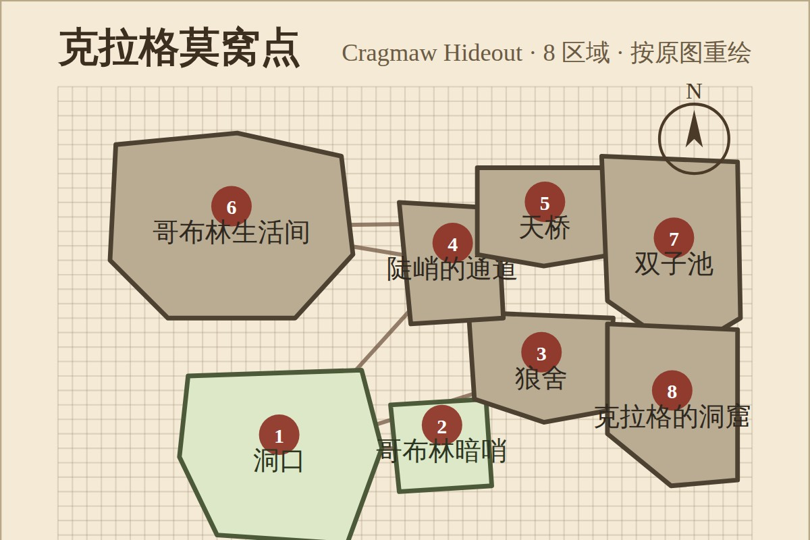
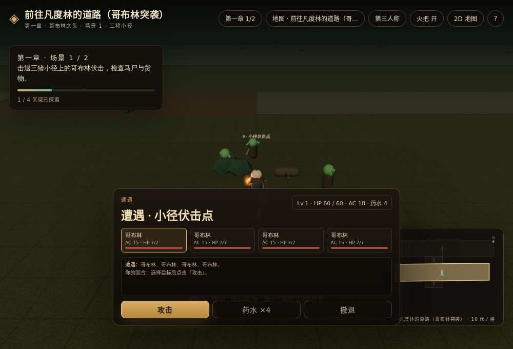
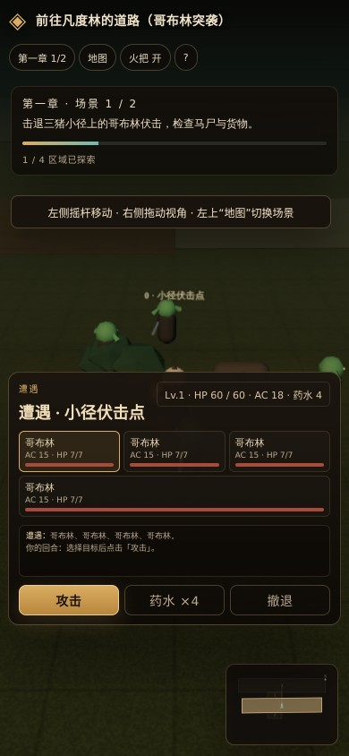
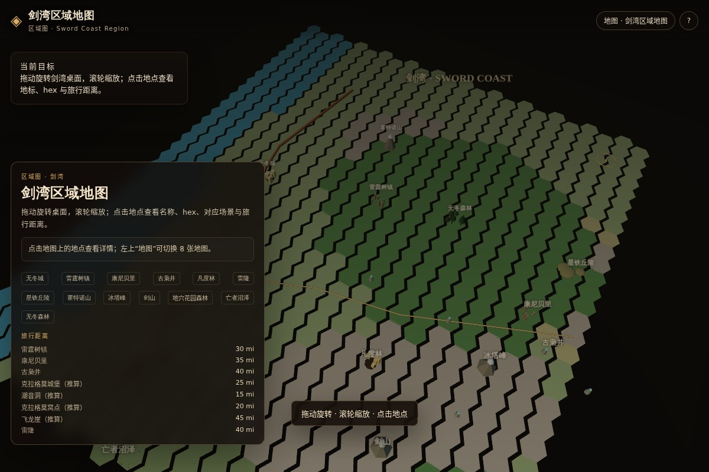

# 第一章 · 哥布林之矢 — 3D 竖切片

> 《凡戴尔的失落矿坑》第一章的 3D 可玩竖切片：**三猪小径伏击 → 克拉格莫窝点 → 救出西达尔**。  
> 试玩：<https://chehua11agent.github.io/superagent-test/prototype/lmop-3d/>

这一版按“一章一章做”的方式只做**第一章**：先把一段完整流程（场景、遭遇、战斗、目标、章节结束）跑通，再谈第二章。其余 7 张地图仍保留在「自由探索」里，方便看场景，但**不串进第一章剧情**。

## 第一章包含什么

| 场景 | 地图 | 内容 |
|---:|---|---|
| 1 · 三猪小径 | 前往凡度林的道路 | 4 只哥布林伏击、2 匹死马、被洗劫的鞍囊；战斗胜利后检查货物，追向窝点 |
| 2 · 克拉格莫窝点 | 克拉格莫窝点 | 哥布林暗哨、狼舍、天桥、生活间、双子池、克拉格洞窟；击败克拉格，救出西达尔 |

- 开场点「开始第一章」进入剧情；每场战斗胜利后短暂休息，生命与药水恢复。
- 场景 1 完成 → 场景 2；击败克拉格 → 第一章完成，西达尔告诉你刚铎被带去克拉格莫城堡。
- 第一章结束后显示「第二章（凡度林 / 红烙印）待制作」，不自动进入第二章。
- 左上「地图」可随时自由探索 8 张地图；「自由探索」按钮从开场直接进沙盒。

## 战斗（简化回合制）

这是为竖切片做的轻量战斗，不是完整 5e：

- 进入有敌人的区域会出现「进入战斗」；点击后锁定移动，进入回合制。
- 你的回合：选目标 →「攻击」；`d20 + 攻击加值` 对 AC，命中后掷伤害骰。
- 敌人回合：每个活着的敌人各攻击一次；`d20 + 攻击加值` 对玩家 AC。
- 「药水」恢复 `2d4+2`，消耗一瓶；「撤退」离开战斗，敌人保留。
- 战斗胜利：获得 XP，敌人消失，短暂休息回满生命并补 1 瓶药水。
- 战斗失败：回到章节起点，恢复生命/药水后重试；不会丢档（本来也没有存档）。
- 第一章角色：场景 1 为 Lv.1（HP 60 / AC 18 / +7 / 2d6+4），场景 2 升到 Lv.2（HP 80 / AC 19 / +8 / 2d8+4），确保竖切片能完整跑通。

简化怪物数据（SRD 5.1 风格，非完整数据卡）：

| 怪物 | AC | HP | 攻击 | 伤害 | XP |
|---|---:|---:|---|---:|---:|
| 哥布林 | 15 | 7 | +4 | 1d6+2 | 50 |
| 狼 | 13 | 11 | +4 | 2d4+2 | 50 |
| 裂皮（狼） | 14 | 18 | +5 | 2d6+3 | 100 |
| 熊地精（克拉格） | 16 | 27 | +4 | 2d8+2 | 200 |

## 8 张地图（自由探索）

| 地图 | 类型 | 区域/地点 |
|---|---|---:|
| 剑湾区域地图 | 区域图 | 17 个地点；3D hex 沙盘，点击看旅行距离 |
| 前往凡度林的道路 | 战斗地图 | 4；第一章场景 1 |
| 克拉格莫窝点 | 地下城 | 8；第一章场景 2 |
| 红烙印大本营 | 地下城 | 12；第二章待制作 |
| 雷霆树镇废墟 | 野外地点 | 13；支线/后续 |
| 克拉格莫城堡 | 地下城 | 14；第三章待制作 |
| 潮音洞 | 地下城 | 20；终章待制作 |
| 凡度林镇 | 城镇 | 18；第二章待制作 |

自由探索仍是同一套 3D 生成器：`maps.json` 的 `footprint` → 地板/墙体，`ceiling_ft` → 墙高，`light` → 光照/地板色，`terrain`/`props` → 低模物件，`connections` → 可走通道/门框；区域触发读取 `rules-crossref.json` 的摘要、规则、出口、敌人。

## 操作

- **剧情**：开场「开始第一章」；左上「第一章 1/2」可回到当前场景；「地图」进入自由探索。
- 可走入地图：`WASD` / 方向键移动；`Shift` 疾走；拖动鼠标旋转；滚轮缩放；`F` 火把；`R` 回起点。
- 战斗：选择敌人卡片 →「攻击」；低血量用「药水」；「撤退」离开。
- 手机：左侧摇杆移动，右侧拖动视角；战斗面板在下方，自动隐藏摇杆。

## 数据与代码

```text
data/lmop/maps.json           区域多边形、净高、光照、地形、物件、连接
data/lmop/rules-crossref.json 场景摘要、规则、怪物、奖励
data/lmop/rules.json          规则中文名
        │
        ▼
world.js   地板/墙/门框/水域/桥/物件/怪物/角色
region.js  剑湾 24×32 hex 3D 沙盘
main.js    第一章状态机、战斗回合、区域触发、HUD、地图切换、移动端
```

第一章状态机在 `main.js` 的 `CAMPAIGN`：两张场景卡、目标区域、章节结尾文本；战斗数据在 `MONSTER_STATS` / `PLAYER_BASE`。后续接第二章时，只需增加场景卡和对应地图，不需要改场景生成器。

## 范围与边界

- **只做了第一章**：第二章（凡度林 / 红烙印）、第三章、终章仍是待制作；自由探索里的地图是场景预览，不是完整剧情。
- **战斗是简化回合制**：没有完整 5e 动作/附赠动作/反应/法术/豁免/先攻/掩体/多点伤害；AC、HP、攻击、伤害、药水、XP 是竖切片所需的最小集。
- **没有存档**：刷新即重置；没有多人/DM 模式。
- **美术是程序化低模**：不使用原图扫描或 WotC 官方美术；地下城几何误差约 ±1 格。
- **战斗数值为可玩性调整**：角色 HP/等级高于标准 1 级角色，以保证第一章竖切片能完整跑通；正式版会按 5e 等级与遭遇预算重做。

## 本地运行

从仓库根目录启动静态服务器（不能直接双击 HTML，因为要 `fetch` JSON）：

```bash
python3 -m http.server 4174
# http://127.0.0.1:4174/prototype/lmop-3d/
```

调试参数：

- `?map=map-cragmaw-hideout` 直接打开某张地图（自由探索）
- `?intro=0` 跳过开场
- `?spawn=5` / `?spawn=8` 从指定区域开始
- `?qa=1` 低像素比
- 控制台 `__LMOP3D__.goTo(8)`、`__LMOP3D__.winCombat()` 可快速检查章节（调试用）

## 视觉

**Before — 2D 地图数据（1200×800 基线）**



**After — 第一章**








## 验证

- 第一章完整流程：三猪小径战斗 → 场景 1 完成 → 克拉格莫窝点 → 克拉格战斗 → 场景 2 完成 → 第一章完成面板。
- 战斗：攻击/药水/撤退/胜利结算/失败重生；移动锁定；敌人死亡消失。
- 8 张地图自由探索可切换；区域图 17 个地点；区域触发与小地图正常。
- 手机 390：战斗面板无横向溢出，摇杆在战斗时隐藏。
- 数据仍由 `scripts/lmop-atlas-validate.mjs` 与 `npm test` 校验。

## 来源 / 许可

- 模组结构与区域名参考用户提供的《凡戴尔的失落矿坑》中文 PDF；不复制原文、不附带 PDF、不使用官方美术。
- 机制参考 SRD 5.1（CC-BY-4.0）；D&D / 龙与地下城是 Wizards of the Coast 的商标，本页为非官方同人演示。
- three.js r160，MIT，见 `vendor/THREE-LICENSE.txt`。
