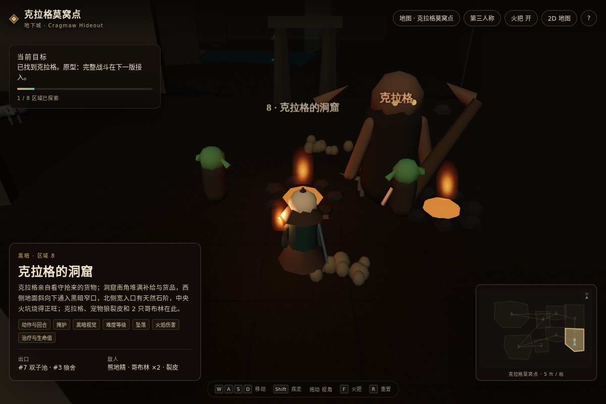
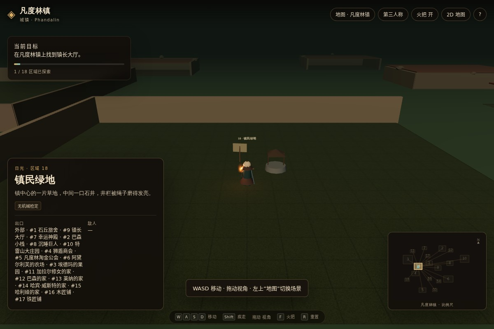
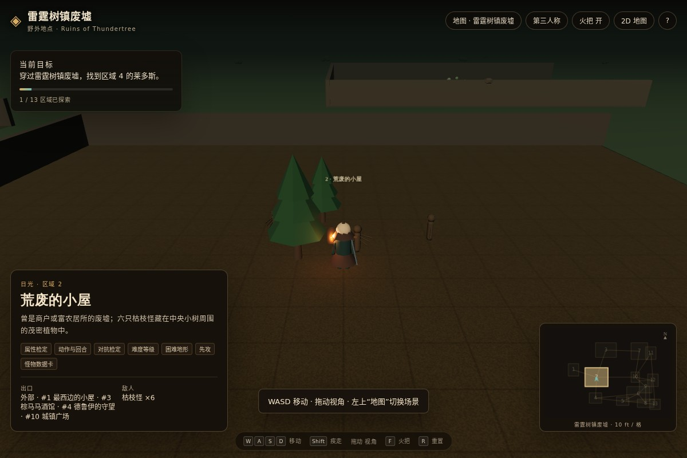
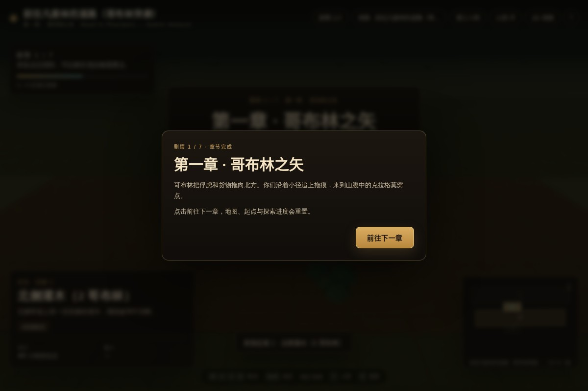
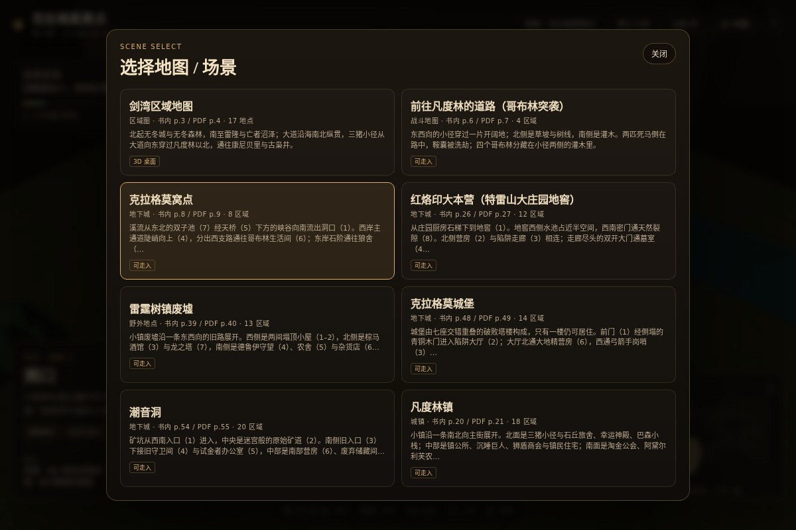
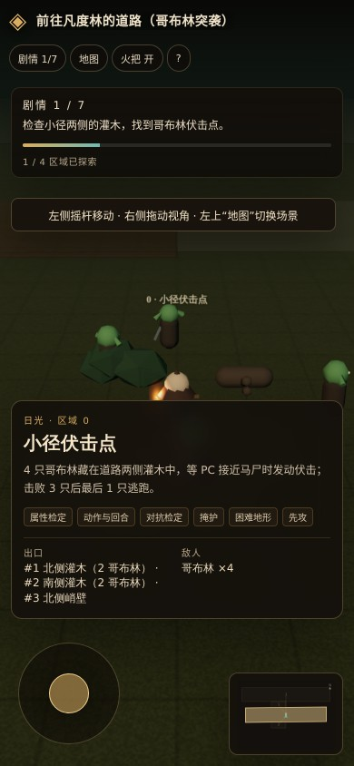

# 凡戴尔的失落矿坑 · 3D 场景集

> 把 `data/lmop/maps.json` 里**整本剧本**的地图几何、光照、物件与连接，生成成可以按剧情推进、也可以自由切换的 3D 场景集。  
> 试玩：<https://chehua11agent.github.io/superagent-test/prototype/lmop-3d/>

这不是只做克拉格莫窝点一个场景：**8 张地图 / 89 个区域与地点**都在同一页里。默认按**7 章主线**推进；也可以「自由探索」直接切换地图。它仍是**方向确认版**，不是完整游戏：没有完整战斗、存档和正式游戏接入。

## 8 张地图

| 地图 | 类型 | 区域/地点 | 3D 形式 |
|---|---|---:|---|
| 剑湾区域地图 | 区域图 | 17 个地点 | 24×32 hex 的 3D 桌游沙盘；拖拽旋转、滚轮缩放、点击地点 |
| 前往凡度林的道路 | 战斗地图 | 4 个区域 | 户外小径、灌木、死马、哥布林伏击 |
| 克拉格莫窝点 | 地下城 | 8 个区域 | 可走入洞穴；暗溪、支流、天桥、瀑布、狼舍、克拉格洞窟 |
| 红烙印大本营 | 地下城 | 12 个区域 | 可走入地窖；水池、裂隙、双桥、密门、墓室 |
| 雷霆树镇废墟 | 野外地点 | 13 个区域 | 可走入废墟；树、枯枝怪、灰烬僵尸、龙之塔 |
| 克拉格莫城堡 | 地下城 | 14 个区域 | 可走入破败城堡；七塔、宴会厅、神殿、王之居所 |
| 潮音洞 | 地下城 | 20 个区域 | 可走入矿坑；黑水池、真菌洞窟、冶炼厂、神殿 |
| 凡度林镇 | 城镇 | 18 个区域 | 可走入小镇；旅舍、商铺、公会、庄园、镇民住宅 |

## 这一版做了什么

- **统一 3D 生成器**：`maps.json` 的 `footprint` 变成地板/墙体，`ceiling_ft` 决定墙高，`light` 决定光照与地板色，`terrain`/`props` 变成低多边形物件，`connections` 变成可走通道与门框。
- **剧情模式**：7 章主线（突袭 → 窝点 → 凡度林 → 红烙印 → 雷霆树镇 → 城堡 → 潮音洞），到达目标推进章节，自动切换地图。
- **地图切换**：左上「地图」打开 8 张地图卡片；切换后重建场景、重置起点与探索进度。
- **区域触发**：走进区域读取 `rules-crossref.json` 的场景摘要、规则标签、出口、敌人与探索进度；到达目标区域触发遭遇/到达面板。
- **各自的地标**：窝点的暗溪/天桥/瀑布、红烙印的水池/裂隙/双桥、雷霆树镇的树与废墟、城堡的塔楼、潮音洞的黑水池、凡度林的房屋/水井/告示板。
- **区域图 3D 沙盘**：24×32 hex、地形色、道路/小径、城市/废墟/山峰/森林/沼泽标记与标签；点击地点查看 hex、对应场景与旅行距离。
- **游戏化 HUD**：目标、探索进度、区域卡、小地图、火把开关、第一/第三人称、重置。
- **移动端**：390 竖屏适配，左侧摇杆 + 右侧视角拖动区；地图切换可用。

## 剧情流程（7 章主线）

点「开始剧情」后，按模块的主线顺序推进；到达目标区域会弹出章节完成卡，点「前往下一章」自动切到下一张地图并重置起点/探索进度。

| 章 | 地图 | 目标 |
|---:|---|---|
| 1 | 前往凡度林的道路 | 找到三猪小径的哥布林伏击点 |
| 2 | 克拉格莫窝点 | 找到区域 8 的克拉格，救出西达尔 |
| 3 | 凡度林镇 | 到镇长大厅报到，接下红烙印任务 |
| 4 | 红烙印大本营 | 找到区域 12 的水晶之杖 |
| 5 | 雷霆树镇废墟 | 找到区域 4 的莱多斯，问出城堡位置 |
| 6 | 克拉格莫城堡 | 找到区域 14 的刚铎，夺回潮音洞地图 |
| 7 | 潮音洞 | 找到区域 19 的奈兹纳尔，结束黑蜘蛛阴谋 |

- 章节完成条件目前是**到达目标区域**，不是完整战斗结果；先验证“流程/场景/目标”跑通。
- 「剧情」按钮在自由探索后可以回到当前章节；「地图」按钮可随时离开剧情线自由看场景。
- 章节卡、目标面板、章节过渡和地图切换都由同一份 `CAMPAIGN` 配置驱动，后续接战斗/检定/存档时不需要改场景生成器。

## 操作

- **剧情**：开场「开始剧情」按 7 章推进；左上「剧情」可查看/回到当前章节。
- **地图**：左上「地图」打开 8 张地图选择；选任意地图会进入自由探索。
- 可走入地图：`WASD` / 方向键移动；`Shift` 疾走；拖动鼠标旋转；滚轮缩放；`F` 火把；`R` 回起点。
- 区域图：拖动旋转桌面；滚轮缩放；点击地点查看详情；面板内地点按钮也可切换。
- 手机：左侧摇杆移动，右侧拖动看；顶部「地图」切换场景。

## 数据怎么进入 3D

```text
data/lmop/maps.json           区域多边形、净高、光照、地形、物件、连接
data/lmop/rules-crossref.json 场景摘要、规则、怪物、奖励
data/lmop/rules.json          规则中文名（HUD 标签）
        │
        ▼
world.js   把 footprint 变成地板/墙/门框；把 props 变成低多边形物件；
           把 monsters 变成哥布林/狼/熊地精/骷髅/蜘蛛/龙等；把 connections 变成可走通道
region.js  把 24×32 hex、地点、道路、地形色生成 3D 区域沙盘
main.js    地图切换、第三人称/区域相机、区域触发、HUD、小地图、移动端控制
```

关键约定：

- 地图坐标是英尺，`x` 向东、`y` 向南；Three.js 里 `x→x`、`y→z`、`y` 轴向上。
- 区域 `footprint` 直接作为地板多边形；`ceiling_ft` 用于墙高/洞穴壳；`light` 决定地板色与区域卡光照。
- 区域图的 `hex` 是 5 英里/格；`routes` 是大道/三猪小径；`travel` 是旅行距离。
- 地形/物件是示意低模，不复刻原图美术；原图版权归 Wizards of the Coast。

## 目录

```text
prototype/lmop-3d/
  index.html      开场 / HUD / 区域卡 / 小地图 / 地图选择 / 移动端摇杆
  styles.css      暗色洞穴主题、区域面板、地图选择、响应式
  main.js         地图切换、渲染循环、相机、移动/碰撞、区域触发、HUD
  world.js        地下城/野外/城镇的地板/墙/水/桥/物件/怪物/角色
  region.js       剑湾 24×32 hex 3D 沙盘、地点标记、道路、旅行面板
  vendor/         three.js r160（MIT）
  screenshots/    before/after 与移动端截图
  README.md
```

## 范围与已知边界

- **8 张地图都有 3D 版**，但精度/完成度不同：地下城与窝点最细；城镇、废墟、区域图是示意低模。不是最终美术资产。
- **不是完整游戏**：没有战斗回合、先攻、伤害、掉落、存档、多人或 DM 模式；目标区域只有到达/遭遇面板。
- **几何是示意**：由 `maps.json` 的方格/比例尺重绘，天然洞穴边界与塔楼为多边形近似；误差约 ±1 格。
- **没有原图扫描**：不附带 LMoP PDF，不使用 WotC 官方美术；模型与贴图为程序化生成。
- **性能**：低端手机可能掉帧；`?qa=1` 会降低像素比。桌面浏览器建议开启硬件加速。

## 本地打开

从**仓库根目录**启动静态服务器（不能直接双击 `index.html`，因为要 `fetch` JSON）：

```bash
python3 -m http.server 4174
# http://127.0.0.1:4174/prototype/lmop-3d/
```

调试参数：

- `?map=map-sword-coast-region` 直接打开某张地图（8 个 id 见 `maps.json`）
- `?intro=0` 跳过开场
- `?spawn=5` / `?spawn=8` 从指定区域开始
- `?view=first` 第一人称
- `?qa=1` 低像素比

## 视觉

**Before — 2D 地图数据（同一场景、1200×800 基线）**


**After — 8 张地图 3D 场景**







**After — 地图选择 / 开场 / 手机 390**






## 验证

- 8 张地图均可切换并加载；区域图 17 个地点、地下城 8/12/14/20 个区域、城镇 18 个区域。
- 区域触发、目标到达弹窗、第一人称、地图选择、区域图地点点击/旅行距离、手机 390 无横向溢出。
- 无 console/page error。
- 数据仍由 `scripts/lmop-atlas-validate.mjs` 与 `npm test` 校验。

## 来源 / 许可

- 模组结构与区域名参考用户提供的《凡戴尔的失落矿坑》中文 PDF；不复制原文、不附带 PDF、不使用官方美术。
- 机制参考 SRD 5.1（CC-BY-4.0）；D&D / 龙与地下城是 Wizards of the Coast 的商标，本页为非官方同人演示。
- three.js r160，MIT，见 `vendor/THREE-LICENSE.txt`。
