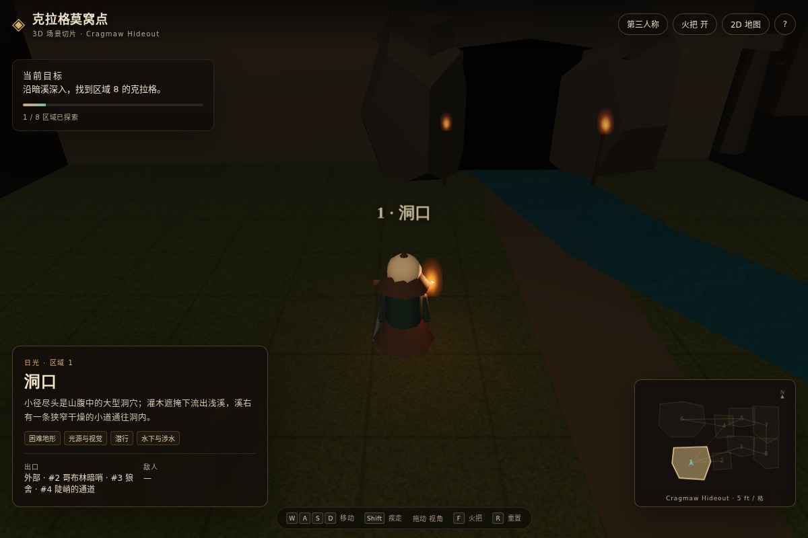
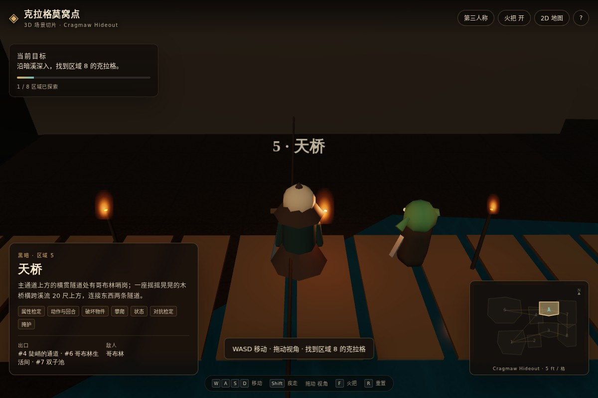

# 凡戴尔的失落矿坑 · 3D 场景切片（克拉格莫窝点）

> 把 `data/lmop/maps.json` 里的地图几何、光照、物件与连接，真正生成成可以走进去的 3D 洞穴。  
> 试玩：<https://chehua11agent.github.io/superagent-test/prototype/lmop-3d/>

这是**方向确认用**的场景切片，不是完整游戏：只有一个地下城（克拉格莫窝点），没有完整战斗、存档和多地图切换。先确认“2D 数据 → 3D 场景”的画风、视角与交互，再往游戏里接。

## 这一版做了什么

- **8 个区域全部 3D 化**：洞口、哥布林暗哨、狼舍、陡峭通道、天桥、哥布林生活间、双子池、克拉格洞窟。
- **由 JSON 驱动**：地面多边形来自 `maps.json` 的 `footprint`，净高来自 `ceiling_ft`，光照/地形/物件来自 `light`/`terrain`/`props`，出口来自 `connections`。
- **场景元素**：暗溪、支流、瀑布、木桥、火坑、火把、木桶、板条箱、武器架、石笋、骸骨、营房铺盖、祭坛/雕像等程序化低多边形物件。
- **区域触发**：走进区域会读取 `rules-crossref.json` 的场景摘要、规则标签、出口、怪物与探索进度；区域 8 触发克拉格遭遇面板。
- **游戏化 HUD**：目标、探索进度、区域卡、小地图、火把开关、第一/第三人称、重置。
- **移动端**：390 竖屏适配，左侧摇杆 + 右侧视角拖动区。

## 操作

- `WASD` / 方向键：移动；`Shift`：疾走。
- 拖动鼠标：旋转视角；滚轮：拉近/拉远。
- `F`：火把开关；`R`：回到洞口。
- 走进区域会自动更新左侧区域卡；小地图显示已探索区域与玩家位置。
- 手机：左侧摇杆移动，右侧拖动看；顶部按钮切换视角/火把。

## 数据怎么进入 3D

```text
data/lmop/maps.json           区域多边形、净高、光照、地形、物件、连接
data/lmop/rules-crossref.json 场景摘要、规则、怪物、奖励
data/lmop/rules.json          规则中文名（HUD 标签）
        │
        ▼
world.js  把 footprint 变成地板/墙/门框；把 props 变成低多边形物件；
          把 monsters 变成哥布林/狼/熊地精；把 connections 变成可走通道
        │
        ▼
main.js   第三人称角色、区域触发、HUD、小地图、移动端控制
```

关键约定：

- 地图坐标是英尺，`x` 向东、`y` 向南；Three.js 里 `x→x`、`y→z`、`y` 轴向上。
- 区域 `footprint` 直接作为地板多边形；`ceiling_ft` 用于墙高/洞穴壳；`light` 决定地板色与区域卡光照。
- 连接只做“可走通道”与门框，不逐格建墙；洞口、天桥、瀑布等关键地标单独建模。
- 地形/物件是示意低模，不复刻原图美术；原图版权归 Wizards of the Coast。

## 目录

```text
prototype/lmop-3d/
  index.html      开场 / HUD / 区域卡 / 小地图 / 移动端摇杆
  styles.css      暗色洞穴主题、响应式
  main.js         渲染循环、第三人称相机、移动/碰撞、区域触发、HUD
  world.js        地板/墙/水/桥/物件/怪物/角色/光照的程序化建模
  vendor/         three.js r160（MIT）
  screenshots/    before/after 与移动端截图
  README.md
```

## 范围与已知边界

- **只有一个场景**：克拉格莫窝点（Cragmaw Hideout）。红烙印、凡度林、潮音洞、克拉格莫城堡还没有 3D 切片。
- **不是完整游戏**：没有战斗回合、先攻、伤害、掉落、存档、多人或 DM 模式；区域 8 只有遭遇面板。
- **几何是示意**：由 `maps.json` 的方格/比例尺重绘，天然洞穴边界与塔楼为多边形近似；误差约 ±1 格。
- **没有原图扫描**：不附带 LMoP PDF，不使用 WotC 官方美术；模型与贴图为程序化生成。
- **性能**：低端手机可能掉帧；`?qa=1` 会降低像素比。桌面浏览器建议开启硬件加速。

## 本地打开

从**仓库根目录**启动静态服务器（不能直接双击 `index.html`，因为要 `fetch` JSON）：

```bash
python3 -m http.server 4174
# http://127.0.0.1:4174/prototype/lmop-3d/
```

调试参数：

- `?intro=0` 跳过开场
- `?spawn=5` / `?spawn=8` 从指定区域开始
- `?view=first` 第一人称
- `?qa=1` 低像素比

## 验证

- 打开页面无 console/page error；8 个区域都能触发并更新区域卡。
- `window.__LMOP3D__.goTo(n)` 可跳区域；区域 8 触发遭遇弹窗；关闭后目标更新。
- 桌面 1200×800 与手机 390×844 截图；手机无横向溢出。
- 数据仍由 `scripts/lmop-atlas-validate.mjs` 与 `npm test` 校验。

## 来源 / 许可

- 模组结构与区域名参考用户提供的《凡戴尔的失落矿坑》中文 PDF；不复制原文、不附带 PDF、不使用官方美术。
- 机制参考 SRD 5.1（CC-BY-4.0）；D&D / 龙与地下城是 Wizards of the Coast 的商标，本页为非官方同人演示。
- three.js r160，MIT，见 `vendor/THREE-LICENSE.txt`。

## 视觉

**Before — 2D 地图数据（同一场景、1200×800 基线）**


**After — 进入洞穴 / 天桥 / 克拉格洞窟**





**After — 开场 / 手机 390**


