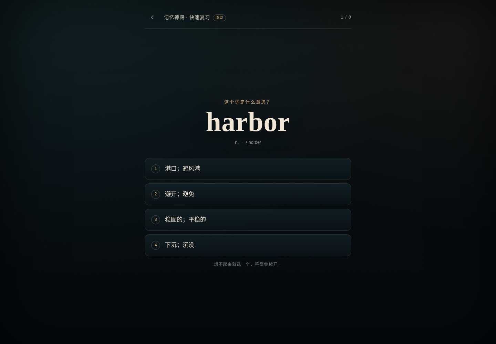

# 快速复习 · 「一句话 + 大按钮」原型

《拾词者 · 雾港》复习界面的**画面形式原型**：一屏只做一个决定，把「认义」复习压到一句话 + 4 个大按钮。

> 这不是完整功能，也不改动现有的 `game/`。它回答一个问题：
> **把复习改成「一句话 + 大按钮」，阅读负担会不会明显降低，值不值得进主游戏？**



## 试玩

原型是**单文件、零依赖**的，不需要安装任何包：

```bash
# 在仓库根目录
python3 -m http.server 4180
# 打开 http://127.0.0.1:4180/prototype/review-big-button/index.html
```

也可以直接双击 `index.html`（`file://`）打开；页面不发任何请求。

操作：点按钮，或按 `1–4` 选择；答完后按 `Enter` / 点「下一张」。共 8 张到期卡。

## 这版改了什么

| 位置 | 现状（`game/` 复习页） | 本原型 |
| --- | --- | --- |
| 题干 | 小字「认义检定 · 看英文，选中文」 | 一句「这个词是什么意思？」 |
| 选项 | 桌面 2×2 网格（半宽，约 62px 高） | 单列全宽按钮，≥ 64px 高，带 1–4 编号 |
| 页面框架 | 舞台插画 + HP / 天数 / 进度 HUD + 页头 + 提示 | 顶栏（返回 / 进度）+ 题目 + 反馈；不放 HUD 和插画 |
| 反馈 | 卡片下方展开，含拼写加试 | 同屏展开：释义 + 例句 + 下次间隔 + 「下一张」；不跳页 |
| 键盘 | 无快捷键 | `1–4` 选择，`Enter` 继续，焦点自动落到「下一张」 |
| 结算 | 现有复习结算 | 8 张的答对 / 答错 / 用时，可「再来一轮」 |

移动端（390×844）和 320×568 都不横向溢出；本题的四个选项与当前游戏里 **harbor** 的选项顺序完全一致，方便直接对照。

## 为什么是「一句话 + 大按钮」

依据 2026-11-09 的《文字 / 卡牌学习游戏的「易读简洁」画面形式调研》（PR #14）：

- 七种形式里，「一句话 + 大按钮」的阅读负担最低，原型成本也最低（1–2 人日）；
- 报告的建议是：**如果只做一件事，就把复习改成「一句话 + 大按钮」**；
- 三条硬规则：一屏一个决策、正文不超过 3 行、选项不超过 4 个。原型按这三条实现。

原型只验证「复习」这一屏，不讨论剧情、战斗和章节地图。

## 数据与还原度

- 8 个词来自 `game/content/words.json` 第一章（harbor / distant / fare / board / deck / tide / silent / arrive）。
- 选项由 `game/src/srs.js` 的 `meaningOptions(word, words, 4, 'review')` 预先算好，与游戏内复习一致。
- 结算按 SRS 展示认义下次间隔：答对升一档（3 天后），答错回 1 天。
- 原型不写存档、不改 `game/`，刷新即重置。

## 验证记录

- 视口：1440×1000、1280×720、390×844、375×667、320×568；初始态与反馈态都一屏放下，`scrollWidth === clientWidth`，无横向溢出。
- 键盘：`1–4` 选择、`Enter` 进入下一张；答完后焦点在「下一张」。
- 8 张完整走到结算；「再来一轮」可重开。
- `prefers-reduced-motion: reduce` 下动画/过渡被关闭。
- 浏览器 `pageerror` 与 console error：0。
- 同一份页面用 `file://` 打开可用（无网络请求）。
- 对照截图（同一题、同一视口、同一主题）：
  - 桌面：`screenshots/before-desktop.jpg` ↔ `screenshots/after-desktop.jpg`
  - 手机：`screenshots/before-mobile.jpg` ↔ `screenshots/after-mobile.jpg`
  - 反馈态：`screenshots/after-feedback-desktop.jpg`、`screenshots/after-feedback-mobile.jpg`
  - 结算：`screenshots/after-done.jpg`；小屏：`screenshots/after-320.jpg`

## 边界与未做

- 静态 8 张卡；不接真正的 SRS 存档、跨天、到期排序。
- 不含拼写加试、双轨徽章、例句发音；这些仍在现有游戏里。
- 阅读负担是设计判断，不是可用性测试结论。上线前应按调研建议找 3–5 人做 A/B：同一批词，对比完成时间、回看次数和误点。
- 未改动主游戏的任何文件；方向确认后再接进 `game/`。

## 如果方向确认，下一步

1. 把复习页换成这套布局，保留现有 SRS / 拼写加试 / 存档逻辑；
2. 桌面端验证 2×2 → 单列的收益，移动端验证是否真的减少回看；
3. 再考虑「2 分钟微会话」：只做 5–8 张到期卡，结算页给 streak 与明日到期数。

## 文件

```text
prototype/review-big-button/
  index.html      单文件原型（内联 CSS / JS / 8 个词）
  README.md       本说明
  screenshots/    before / after 对照截图
```
