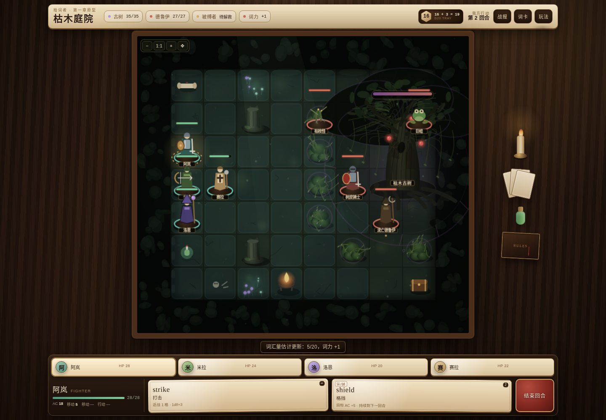

# 枯木庭院 · 俯视角战棋原型

《拾词者》第一章的一个**画面与战斗方向原型**：一场 10×9 格的俯视角回合制战斗。单文件、无构建、无外部素材，打开就能玩。

> 这不是完整章节，也不改动现有的 `game/` 原型。它只回答一个问题：把《拾词者》的战斗换成俯视角战棋，值不值得继续。



## 试玩

- 在线预览：<https://chehua11agent.github.io/superagent-test/prototype/tactical/>
- 本地：在仓库根目录运行 `python3 -m http.server 4180`，打开 <http://127.0.0.1:4180/prototype/tactical/index.html>。

手机竖屏可直接玩。点角色 → 蓝格移动 → 点敌人普攻；点技能按钮再点目标。`Esc` 或点空白处取消。

## 这一章做了什么

**事件结构**（来自用户提供的 5e 冒险集第一章，原型只取最后一场）：

| 原事件 | 原型里的处理 |
| --- | --- |
| 冒险者下到裂谷、进入沉没的城塞 | 开场叙述 + `descend` / `ancient` 两个剧情词 |
| 狗头人与哥布林争夺地城、白龙幼崽被偷 | 开场背景，留给后续章节 |
| 两名冒险者被古树变成“树缚者” | 章节目标 `rescue`；树倒后树皮骑士摆脱控制 |
| 庭院深处的枯木古树与流亡德鲁伊 | 本场战斗的主目标与两名首领 |
| 荆棘丛、真菌光、被移植的庭院植物 | 地图地形：荆棘减速/划伤、菌光、石柱 |

**怪物**（HP / AC / 攻击加值 / 伤害骰 / 易伤与抗性直接按原冒险和 5e 怪物卡换算，没有为了“避嫌”重算平衡）：

| 单位 | HP | AC | 关键能力 |
| --- | ---: | ---: | --- |
| 流亡德鲁伊 | 27 | 11（树皮术 16） | 根须缠绕（力量豁免 DC 13）、毒雾喷吐（体质豁免 DC 12，1d12）、树皮术 |
| 树皮骑士 | 19 | 18 | 长剑 +6，1d8+4；树倒后转为“失控”，攻击德鲁伊 |
| 枯枝怪 ×3 | 4 | 13 | 枝刺 +3，1d4+1；火焰易伤 ×2；小型，无视荆棘减速 |
| 巨蛙 | 18 | 11 | 咬击 +3，1d6+1；第 2 回合从树冠跃下 |
| 枯木古树 | 35 | 10 | 火焰易伤 ×2、穿刺抗性 ÷2；近战攻击它会被荆棘扎 2 点；每三回合播一次种子 |

战斗规则：`d20 + 加值` 对抗 AC；自然 20 暴击、自然 1 必失；控制与毒伤走豁免；先移动再行动（也可以先行动再移动），每名角色每回合移动一次、行动一次。

## 四级词重叠

用仓库里的 4,530 词头四级大纲知识库，对第一章英文正文做词形匹配：**约 1,245 个不同的四级词头**出现在正文里（含高频虚词，基于 OCR 文本，数字为近似值）。

从战斗操作和剧情里挑出 **20 个**做成这一章能看到的词：

| 词 | 释义 | 位置 | 来源 |
| --- | --- | --- | --- |
| strike | 打击 | 阿岚普攻 | 操作补充 |
| shield | 盾；防护 | 阿岚技能 | 正文词 |
| arrow | 箭 | 米拉普攻 | 正文词 |
| aim | 瞄准 | 米拉技能 | 操作补充 |
| flame | 火焰 | 洛恩普攻 | 正文词 |
| magic | 魔法 | 洛恩技能 | 正文词 |
| heal | 治疗 | 赛拉技能 | 正文词 |
| sword | 剑 | 树皮骑士普攻 | 正文词 |
| root | 根 | 德鲁伊控制 | 正文词 |
| bark | 树皮；吠叫 | 德鲁伊增益 | 正文词 |
| poison | 毒 | 德鲁伊法术 | 正文词 |
| thorn | 刺；荆棘 | 古树被动 | 操作补充 |
| seed | 种子 | 古树播种 | 正文词 |
| fruit | 果实 | 剧情物品 | 正文词 |
| rescue | 援救 | 章节目标 | 正文词 |
| surrender | 投降 | 开场事件 | 正文词 |
| descend | 下降 | 开场叙述 | 正文词 |
| ancient | 古老的 | 开场叙述 | 正文词 |
| victory | 胜利 | 战斗结算 | 操作补充 |
| defeat | 击败；挫败 | 战斗结算 | 正文词 |

游戏里的「词卡」抽屉有全部 20 个词的例句；例句为本原型重写。

## 画面与技术

- 纯 Canvas 2D 程序化绘制：石地板、石柱、荆棘、菌光、古树、单位棋子、血条、移动范围、路径预览、伤害数字、火焰/治疗/缠绕/树倒特效。
- 单文件 `index.html`，无网络请求、无第三方库；`prefers-reduced-motion` 会缩短动画。
- 响应式：桌面 1440×1000 与手机 390×844 都验证过；手机端把单位名称收进下方“敌情”条，避免缩得太小。

## 验证

开发时用 Playwright（本机无头 Chromium）实际跑过：

- 封面 → 开场 → 战斗 → 选择角色 → 移动 → 普攻击杀枯枝怪 → 结束回合 → 敌方行动 → 第 2 回合巨蛙事件，控制台 0 错误。
- 古树死亡 → 树皮骑士/枯枝怪转为“失控”（金环）→ 击杀德鲁伊 → 胜利结算 → 再战一次 → 全灭 → 失败结算 → 返回封面，控制台 0 错误。
- 手机 390×844 触摸：点角色、点蓝格、点敌人、词卡抽屉、敌情条点击查看，控制台 0 错误。
- 一次脚本化自动战斗（未提交）在第 5 回合获胜，4 名角色存活 3 名；这是平衡冒烟，不是固定难度。

## 已知边界

- 只有一场战斗，不是完整章节；没有存档、剧情分支、商店或升级。
- 部分法术做了单场简化：根须缠绕是单目标、持续 1 回合；毒雾是单目标；古树播种是演示用的节奏改编；没有借机攻击、掩体、反应与专注检定。
- 数值按 5e 怪物卡换算，但为了让一场能打完，树皮骑士 AC 按 18、古树播种频率和部分冷却做了取舍。
- 公开仓库不收录原书文字、专有名词或完整数据表；场景、对白、词卡例句都是本原型重写的。原书请留给个人学习使用。

## 文件

```text
prototype/tactical/
  index.html                     自包含原型（HTML + CSS + JS + Canvas）
  README.md                      本文件
  screenshots/before-current-battle.png   改动前：main 的雾港词卡战斗（1440×1000）
  screenshots/after-battle-desktop.png    改动后：俯视角战棋（1440×1000）
  screenshots/after-battle-mobile.png     改动后：手机竖屏（390×844）
  screenshots/after-cover.png / after-intro.png / after-action.png / after-words.png / after-victory.png
```
