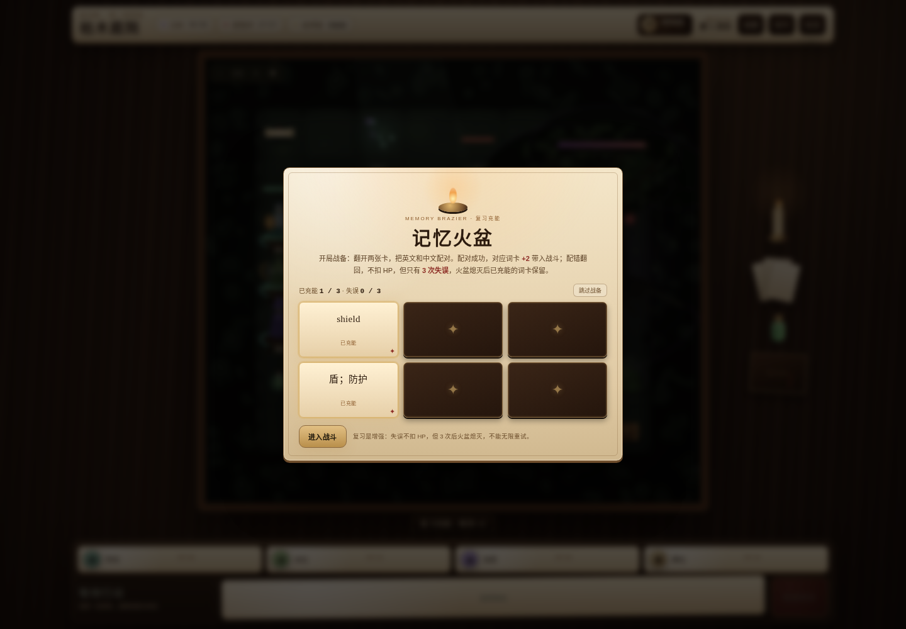

# 枯木庭院 · 鸟瞰桌游式战棋 + 战备复习原型

《拾词者》第一章的**画面与玩法方向原型**：一张木桌上的鸟瞰桌游棋盘，一场 **3–4 回合的短遭遇**。开局先玩一局「记忆火盆」复习，把四级词配成对，给词卡充能，再带着强化进入战斗。

> 这不是完整章节，也不改动现有的 `game/`。它回答三个问题：
> 1. 把战斗换成“鸟瞰桌游”的摆盘，值不值得继续？
> 2. 复习能不能本身就是一个游戏，并且直接增强战斗？
> 3. 一局能不能短到适合每天来一把？



## 试玩

- 在线预览：<https://chehua11agent.github.io/superagent-test/prototype/tactical/>
- 本地：在仓库根目录运行 `python3 -m http.server 4180`，打开 <http://127.0.0.1:4180/prototype/tactical/index.html>。

手机竖屏可直接玩。流程：封面 → 开场剧情 + 8 张词卡 → **战备：记忆火盆** → 4 步战斗教学 → 短遭遇。想被带着走就点封面/开场的「手把手教学」。

## 一局的流程

1. **开场词卡**：先给 8 张词卡（英文 + 中文 + 用法位置），这是“先给答案”。
2. **战备：记忆火盆**：翻开 6 张卡，把 3 组英文/中文配对。配对成功，对应词卡 **+2**，最多 **+4**；配错翻回，不扣 HP；可以随时“跳过战备”。这是复习，也是开局增强。
3. **4 步教学**：选角色 → 移动 → 行动 / 词卡 → 结束回合；底部步骤条一直提示。
4. **短遭遇**：4 名 3 级角色对 **4 个敌方单位**（流亡德鲁伊、树皮骑士、1 只枯枝怪、枯木古树）；第 2 回合巨蛙加入。**3–4 回合**结束，不拖长。
5. **带充能战斗**：被充能的词卡显示 `✦+2`；打出时效果直接增强。

## 战备复习：记忆火盆

- 一局 3 组配对（6 张牌）；翻牌配对，配错翻回、不扣 HP，但**累计 3 次失误火盆就会熄灭**，不能无限重试。
- 配对成功 → 对应词卡 +2（`shield` +2 AC、`aim` +2 伤害、`magic` +2 伤害、`heal` +2 回复）；同一张最多 +4。
- 充能会显示在底部手牌的右下角（`✦+2` / `✦+4`），也会写进词卡检定的效果说明。
- 它发生在**战斗开始前**，不是每回合都弹；这样一局更短，复习也不会打断战斗节奏。
- 火盆熄灭后已经充能的词卡保留，直接进入战斗；跳过战备也能打，只是没有充能。复习是增强，不是门槛。

## 手把手教学

想让人带着走一遍，点封面或开场的「手把手教学」：

- 先过战备火盆；然后进入 10 步引导：目标 → 点洛恩（法师）→ 点 magic 词卡 → 点古树 → 检定里认出/选“魔法”/让卡牌生效 → 点阿岚 → 点金色格子移动 → 点枯枝怪 → 点结束回合 → 教学完成。
- 每一步都在真实 UI 上高亮：角色卡/词卡有金框，棋盘格/怪物有金色圆环和箭头；点错会提示，不会把流程带偏。
- 随时可以“跳过教学”；完成后继续这一局，不是另一个训练关。
- 常规的「怎么玩」4 步卡片仍然保留，给不想被强制引导的人。

## 桌游画面

- **鸟瞰棋盘**：木质桌面上放一块带铜角与厚木框的棋盘；棋盘上是被荆棘占满的庭院。
- **实体棋子**：四名冒险者和怪物都是立在圆形底座上的小模型；职业、武器和颜色不同，底座圈色区分敌我。
- **场景道具**：枯木古树、断裂石柱、荆棘丛、菌光、仪式圆环、火盆、宝箱、药瓶、骨头、卷轴；树干里嵌着两个被树吞进去的人影。
- **桌面道具**：右侧有蜡烛、一叠词卡、药瓶和规则书；顶部是 d20 骰盘，攻击/豁免会显示最近一次投掷；底部的手牌是羊皮纸词卡，角色卡、战报和词表也是纸/皮革质感。
- 全部用 Canvas 2D + CSS 程序化绘制，没有外部图片或字体依赖；`prefers-reduced-motion` 会缩短动画。

**可缩放棋盘**：棋盘左上角有 `− / 1:1 / + / ✥`。`+`/`−` 或鼠标滚轮缩放（1×–2.5×），`✥` 打开后拖动棋盘平移，`1:1` 复位。名字不再浮在头顶，而是刻在每个棋子底座的铭牌上；古树的名字在树干底座的铭牌上。

## 剧情、怪物与短局配置

事件结构来自用户提供的 5e 冒险集第一章；原型只取最后的庭院战，并把它压成短遭遇：

| 原事件 | 原型里的处理 |
| --- | --- |
| 冒险者下到裂谷、进入沉没的城塞 | 开场叙述 + `descend` / `ancient` 剧情词 |
| 狗头人与哥布林争夺地城、白龙幼崽被偷 | 开场背景，留给后续章节 |
| 两名冒险者被古树变成“树缚者” | 章节目标 `rescue`；树倒后树皮骑士摆脱控制 |
| 庭院深处的枯木古树与流亡德鲁伊 | 本场战斗的主目标与两名首领 |
| 荆棘丛、真菌光、被移植的庭院植物 | 棋盘地形与场景道具 |

短局保留了原遭遇的核心单位，只减少数量、去掉古树播种，**没有改这些单位的 5e 数值**：

| 单位 | HP | AC | 关键能力 |
| --- | ---: | ---: | --- |
| 流亡德鲁伊 | 27 | 11（树皮术 16） | 根须缠绕（力量豁免 DC 13）、毒雾喷吐（体质豁免 DC 12，1d12）、树皮术 |
| 树皮骑士 | 19 | 18 | 长剑 +6，1d8+4；树倒后转为“失控”，攻击德鲁伊 |
| 枯枝怪 ×1 | 4 | 13 | 枝刺 +3，1d4+1；火焰易伤 ×2；小型，无视荆棘减速 |
| 巨蛙 | 18 | 11 | 咬击 +3，1d6+1；第 2 回合从树冠跃下 |
| 枯木古树 | 35 | 10 | 火焰易伤 ×2、穿刺抗性 ÷2；近战攻击它会被荆棘扎 2 点 |

战斗是 `d20 + 加值` 对抗 AC，自然 20 暴击、自然 1 必失；控制和毒伤走豁免。

用仓库里的 4,530 词头四级大纲知识库，对第一章英文正文做词形匹配：**约 1,245 个不同的四级词头**出现在正文里（含高频虚词，基于 OCR 文本，数字为近似值）。从战斗操作和剧情里挑出 **20 个**，其中 8 个放进开场词卡：

| 词 | 释义 | 位置 | 来源 |
| --- | --- | --- | --- |
| strike | 打击 | 阿岚普攻 | 操作补充 |
| shield | 盾；防护 | 阿岚词卡（检定 / 可充能） | 正文词 |
| arrow | 箭 | 米拉普攻 | 正文词 |
| aim | 瞄准 | 米拉词卡（检定 / 可充能） | 操作补充 |
| flame | 火焰 | 洛恩普攻 | 正文词 |
| magic | 魔法 | 洛恩词卡（检定 / 可充能） | 正文词 |
| heal | 治疗 | 赛拉词卡（检定 / 可充能） | 正文词 |
| sword | 剑 | 树皮骑士普攻 | 正文词 |
| root | 根 | 德鲁伊控制 | 正文词 |
| bark | 树皮；吠叫 | 德鲁伊增益 | 正文词 |
| poison | 毒 | 德鲁伊法术 | 正文词 |
| thorn | 刺；荆棘 | 古树被动 | 操作补充 |
| seed | 种子 | 剧情词（短局不召唤） | 正文词 |
| fruit | 果实 | 剧情物品 | 正文词 |
| rescue | 援救 | 章节目标 | 正文词 |
| surrender | 投降 | 开场事件 | 正文词 |
| descend | 下降 | 开场叙述 | 正文词 |
| ancient | 古老的 | 开场叙述 | 正文词 |
| victory | 胜利 | 战斗结算 | 操作补充 |
| defeat | 击败；挫败 | 战斗结算 | 正文词 |

游戏里的「词卡」抽屉有全部 20 个词的例句；例句为本原型重写。

## 这一版改了什么（针对反馈）

- **“复习也应该是游戏，甚至成为游戏增强”** → 战备「记忆火盆」：翻牌配对词义，给对应词卡充能；充能直接写进卡牌效果。
- **“复习本身就是战备的一个环节，一局要短”** → 火盆移到开场战备，不再每回合弹；短遭遇只留 4 个敌方单位 + 第 2 回合巨蛙，去掉古树播种，3–4 回合结束。
- **“能不能来一个手把手教学”** → 新增 10 步教练：真实界面上金框/金色圆环高亮，必须按提示完成选角、词卡检定、移动、攻击、结束回合；可跳过，完成后继续这一局。
- **“火盆属于加强，不能无限机会；画面太小不能缩放；名字集成在棋子上”** → 火盆改为 **3 次失误即熄灭**，已充能保留、不扣 HP；棋盘加 `−/1:1/+/✥` 缩放与拖动平移；名字从浮动标签移到棋子底座铭牌，古树在树干底座。
- 此前已做：鸟瞰桌游摆盘、实体棋子/道具、4 步教学、剧情词卡 + 认出/拼写检定。

## 验证

开发时用 Playwright（本机无头 Chromium）实际跑过：

- 封面 → 开场 → **战备记忆火盆**（配对成功，`heal` 卡 +2）→ 4 步教学 → 选角 → 移动 → 普攻 → 词卡检定 → 敌方行动 → 第 2 回合巨蛙 → 短局结束；0 控制台错误。
- 战备跳过 → 直接教学/战斗；充能卡显示 `✦+2`，词卡检定效果里带“复习充能 +2”；0 控制台错误。
- 手把手教学：封面/开场进入 → 战备跳过 → 10 步（洛恩 → magic → 古树 → 认出/选魔法/生效 → 阿岚 → 金格 → 枯枝怪 → 结束回合 → 完成）→ 0 控制台错误；手机 390×844 同步验证。
- 火盆有限失误：连续配错 3 次 → 面板显示“火盆已经熄灭”、失误 3/3、所有牌禁用、没有重试入口；直接进入战斗；0 控制台错误。
- 棋盘缩放：1.5×、拖动平移（transform 带 -122/-110 位移）、1:1 复位；名字在底座、古树铭牌可见；0 控制台错误。
- 古树死亡 → 树皮骑士/枯枝怪“失控” → 击杀德鲁伊 → 胜利；全灭 → 失败：0 控制台错误。
- 手机 390×844：封面、开场、战备火盆、教学、选角、移动、攻击、词表抽屉：0 控制台错误。
- GitHub Pages 线上预览手机视口加载 → 封面 → 战备 → 战斗：HTTP 200，0 控制台错误。

## 已知边界

- 只有一场短遭遇，不是完整章节；没有存档、剧情分支、商店或升级。
- 这一版把“剧情 → 战备复习 → 词卡 → 战斗”接进一局；完整的每日 SRS、双轨熟练度和章节循环仍在现有 `game/` 里。
- 短局只减少单位数量、去掉古树播种；单位 HP/AC/攻击/伤害仍按 5e 怪物卡，没有重算平衡。
- 根须缠绕单目标 1 回合、毒雾单目标；没有借机攻击、掩体、反应与专注。
- 公开仓库不收录原书文字、专有名词或完整数据表；场景、对白、词卡例句均为本原型重写。
- 环境没有配置合并 CLI，需要人来合并 PR。

## 文件

```text
prototype/tactical/
  index.html                              自包含原型（HTML + CSS + JS + Canvas）
  README.md                               本文件
  screenshots/before-current-battle.png   改动前：main 的雾港词卡战斗（1440×1000）
  screenshots/after-cover.png             鸟瞰棋盘封面（1440×1000）
  screenshots/after-intro.png             开场剧情 + 8 张词卡（1440×1000）
  screenshots/after-prep.png              战备：记忆火盆（1440×1000）
  screenshots/after-review-limited.png    火盆 3 次失误熄灭（1440×1000）
  screenshots/after-coach.png             手把手教学：点洛恩（1440×1000）
  screenshots/after-coach-check.png       手把手教学：检定选“魔法”（1440×1000）
  screenshots/after-coach-move.png        手把手教学：金色移动格（1440×1000）
  screenshots/after-tutorial.png          4 步教学（1440×1000）
  screenshots/after-battle-desktop.png    短局战斗：底座名字 + 缩放控件（1440×1000）
  screenshots/after-zoom.png              棋盘 1.5× 放大（1440×1000）
  screenshots/after-zoom-pan.png          棋盘放大后拖动平移（1440×1000）
  screenshots/after-check.png             词卡检定（1440×1000）
  screenshots/after-words.png             20 词词表（1440×1000）
  screenshots/after-victory.png           胜利结算
  screenshots/after-cover-mobile.png      手机封面（390×844）
  screenshots/after-coach-mobile.png      手机手把手教学（390×844）
  screenshots/after-prep-mobile.png       手机战备火盆（390×844）
  screenshots/after-battle-mobile.png     手机短局（390×844）
```
